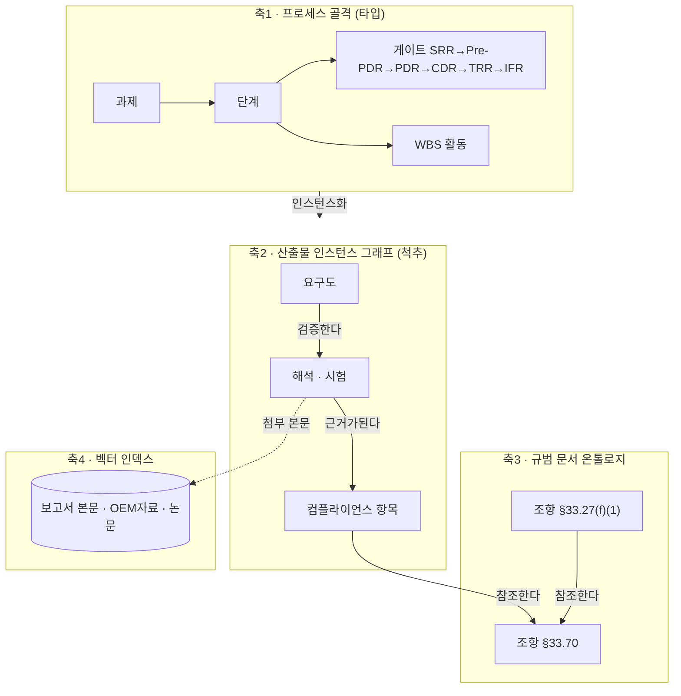
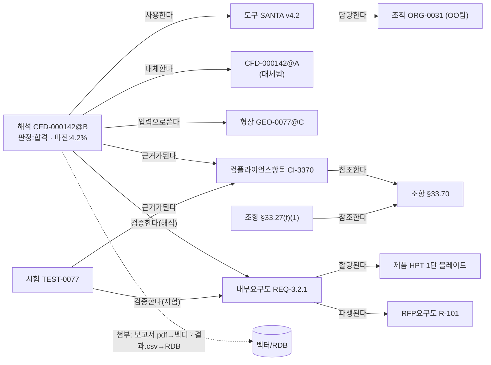

# 엔진 개발 전주기 지식 스키마 v0.2
**온톨로지 · 벡터 하이브리드 — En-Genius 지식 계층 설계서**

| 문서번호 | (공란) | 작성 | (공란) |
|---|---|---|---|
| 일자 | 2026-08-05 | 상태 | 검토용 초안 |

---

## 1. 목적과 범위

RFP-요구도 접수부터 초도생산까지 엔진 개발 전 과정의 **산출물과 그 관계를 온톨로지(그래프)**로 구축하고, 산출물에 매달린 **문서 본문은 벡터 인덱스**로, **수치 데이터는 관계형 DB**로 저장한다.

핵심 동작 원리: **그래프가 검색 범위를 좁히고, 벡터가 그 안을 읽는다.**

### 합격 기준 — 이 스키마가 답해야 할 질의 5종

| # | 질의 | 검증하는 능력 |
|---|---|---|
| Q1 | REQ-3.2.1의 검증 근거와 판정을 전부 | 다중홉 추적 |
| Q2 | 형상 리비전 변경으로 재검토가 필요한 해석 목록 | 캐스케이드 재해석 탐지 |
| Q3 | §33.70 근거 패키지 현황 | 인증 근거 관리 |
| Q4 | CDR 베이스라인 기준 미승인 산출물 | 게이트 베이스라인 |
| Q5 | RFP에서 약속한 요구도 중 검증 미완 항목 | RFP 대사 |

### 온톨로지화 범위 (최소주의)

- **온톨로지화한다**: 프로세스·산출물 유형(축1), 산출물의 식별·관계·리비전(축2), 규범 문서의 조항 구조(축3)
- **온톨로지화하지 않는다**: 해석보고서 본문, OEM 카탈로그, 논문, 트러블슈팅 기록 → 벡터 인덱스 + 메타데이터(축4). 수치 데이터 → RDB + Text-to-SQL

---

## 2. 설계 원칙 8

1. **입도 규칙** — 링크가 앉아야 하는 최소 단위만 노드가 된다. 요구도는 shall문 단위, 규범은 조항 단위, 해석은 케이스 단위. 문서 파일은 노드의 첨부물이지 노드가 아니다.
2. **URI 정책** — `유형접두어-무의미일련번호@리비전` (예: `CFD-000142@B`). 의미는 전부 속성으로. ID 재사용 절대 금지. ID에 의미를 담으면 조직개편·WBS 재편 때 전부 깨진다.
3. **엣지는 리비전을 가리킨다** — 검증한다·입력으로쓴다는 특정 리비전에 건다. 대체한다 엣지와 결합하면 "입력이 구버전이 된 해석"이 질의 하나로 나온다(Q2).
4. **게이트 스냅샷** — 게이트 통과 시점의 그래프를 named graph 베이스라인으로 동결(Q4).
5. **등급 분리** — 노드 메타데이터의 보안등급과 첨부물의 보안등급을 분리한다. 추적성 체인이 소리 없이 끊기는 것을 방지.
6. **조직·도구는 노드다** — 문자열 담당자명은 조직개편에 깨진다. 조직·도구를 노드로 승격하고 승계 이력을 엣지로 남긴다.
7. **결론은 노드 속성으로** — 판정·마진·상태를 노드에 올려 문서를 열지 않고 답한다. 파일 시스템과 지식 시스템의 분기점.
8. **표준 준수** — RDF / SPARQL / OWL / SHACL. 저장소 벤더를 상품(commodity)으로 만들어 종속을 피한다.

---

## 3. 아키텍처 — 4축



- **축1**: 사내 개발절차서를 형식화한 타입 계층. 작고 안정적. 최우선 구축.
- **축2**: 실제 산출물 인스턴스와 교차 링크. 시스템의 중심.
- **축3**: shall이 들어있는 문서의 조항 단위 심층 모델 (Layer B).
- **축4**: 대량·이질·서술형 문서의 벡터 색인. 그래프 노드가 색인 키가 된다.

---

## 4. 타입 계층 (v0.2)

★ = v0.2 신규/변경

```
개체
├─ 과제 (Program) ★                      ← 게이트·WBS는 과제별 인스턴스
├─ 프로세스
│   ├─ 단계 (개념→기본→상세→시제→시험→인증→초도생산)*
│   ├─ 게이트 (SRR, Pre-PDR, PDR, CDR, TRR, IFR)*
│   └─ 활동 / WBS 항목 (노드형)
├─ 조직 (Organization) ★                 ← 담당한다·승계한다의 대상
├─ 도구 (Tool) ★                         ← 소비/생산 포맷 타이핑
├─ 산출물
│   ├─ 요구도 { RFP요구도 | 내부요구도 }
│   ├─ 설계 (설계보고서 · 도면 · 3D모델 · ICD)
│   ├─ 해석 { 스터디 | 케이스 } ★        ← 입도 규칙 적용
│   ├─ 시험 (계획 · 절차 · 결과)
│   ├─ 인증 (컴플라이언스항목 · MoC · 근거패키지)
│   ├─ 관리 (ECR/ECO · 회의록 · 리스크)
│   └─ 참고자료 (OEM자료 · 논문)          ← 노드 최소, 본문은 벡터만
├─ 제품요소 (PBS: 엔진→모듈→부품)         ← WBS보다 수명이 길다
└─ 규범 · 지침
    ├─ 규범 (Part 33, 군 규격 — shall 구속) 
    ├─ 지침 (설계표준서 — 이탈 허용) ★
    └─ 조항 (공통 하위 단위)
```

\* 게이트·단계 명칭은 과제 노드 아래 인스턴스로 정의 — 과제마다 달라도 타입 계층은 불변.

### 해석 입도 규칙 ★

> **엣지가 앉아야 하는 실행만 노드가 된다.**

검증한다·입력으로쓴다·근거가된다가 걸릴 실행(예: 설계점 이차유로 해석) = **케이스 노드**. 주변 파라미터 스윕 수백 회 = **스터디 노드 1개 + RDB 행**. 노드 폭발 방지.

### 설계표준서의 위치 ★

설계표준서는 "전부 만족할 수 없는" 문서이므로 규범이 아니라 **지침**으로 분류한다. 조항 단위 분해는 유지하되, 가치 있는 기록은 준수가 아니라 **이탈**이다 → `이탈한다` 엣지(사유·승인자 속성)만 명시적으로 기록. 양이 적고 가치가 높아 수동 입력으로 감당 가능.

---

## 5. 엣지 어휘 (15종 · 5패밀리)

v0.1의 "10개 이내" 원칙에서 조직·도구·이탈 반영으로 15개까지 확장. **이 이상 늘리지 않는 것을 강권** — 엣지가 전부 "관련있음"이 되는 순간 다중홉이 무너진다.

| 패밀리 | 엣지 | 도메인 → 레인지 | 핵심 속성 |
|---|---|---|---|
| 구조·조직 | 포함한다 | 단계→게이트, 규격→조항 | |
| | 부분이다 | 부품→모듈→엔진 | |
| | 산출한다 | 활동→산출물 | |
| | 담당한다 ★ | 산출물·도구·WBS→조직 | 시작일 |
| | 승계한다 ★ | 조직→조직 | 개편일, 유형(개명/통합/분할) |
| 요구도 | 분해된다 | 요구도→요구도 | |
| | 파생된다 | 내부요구도→RFP요구도 | |
| | 할당된다 | 요구도→제품요소 | |
| 검증 | 검증한다 | 해석·시험→요구도@rev | 검증방법(시험/해석/검사/시연) |
| | 입력으로쓴다 | 해석→산출물@rev | |
| | 사용한다 ★ | 해석·시험→도구@버전 | |
| 규범·인증 | 근거가된다 | 산출물→컴플라이언스항목 | |
| | 참조한다 | 문서·조항·항목→조항 | 표기원문 |
| | 이탈한다 ★ | 설계→지침 조항 | 사유, 승인자 |
| 수명주기 | 대체한다 | Rev N→Rev N-1 | 사유 |

### 엣지 공통 provenance 속성

모든 엣지는 `생성주체(자동추출|시스템동기화|수동주장)`, `생성일`, `승인자`, `근거링크`를 갖는다. → §10 쓰기 거버넌스의 기반.

---

## 6. 공통 속성 및 상태 수명주기

**공통 속성**: ID · 명칭(한/영) · 상태 · 리비전 · 일자 · 보안등급 · 담당조직(→조직 노드) · 단계 · WBS(→WBS 노드) · 분야

**상태 수명주기**: `작성중 → 검토중 → 승인 → (대체됨 | 폐기)` — 삭제는 없다. 대체됨·폐기로만 전이.

**유형별 추가 속성**
- 요구도: shall문, 검증방법, 판정
- 해석: 도구(→도구 노드), 판정, 마진
- 조항: 원문, 적용성
- 도구: 버전, 검증상태(사내검증 기준·일자)

---

## 7. 보안 모델

- **등급**: L1(일반) ~ L5(최고), 사내 등급 체계. 접근 규칙: `사용자등급 ≥ 자산등급`. 국가기밀 체계와의 매핑은 보안조직과 별도 협의(직급 기반이 아닌 need-to-know 원칙).
- **노드/첨부 등급 분리**: "이 해석이 존재하고 REQ-3.2.1을 검증했다"는 사실(노드 메타)은 L2, 보고서 본문(첨부)은 L4 가능. 낮은 등급 사용자에게 추적성 체인이 **소리 없이 끊기는 것**이 최악 — 근거가 없는 건지 안 보이는 건지 구분 불가.
- **존재비닉 플래그**: 존재 자체가 비밀인 산출물만 예외 처리.
- **구획(compartment)**: 도메인/과제 축 필드는 예약만 해두고 Phase 2에서 도입.

---

## 8. 벡터 계층 연동 규약 ★

"그래프가 좁히고 벡터가 읽는다"의 기계적 구현. **벡터DB의 모든 청크는 아래 메타데이터를 필수로 지닌다.**

```json
{
  "chunk_id":      "CFD-000142@B#p12-s3",
  "artifact_uri":  "CFD-000142",
  "rev":           "B",
  "artifact_type": "해석/케이스",
  "section_path":  "4.2 경계조건",
  "grade":         3,
  "status":        "승인",
  "org":           "ORG-0031",
  "phase":         "기본설계",
  "wbs":           "1.3.2",
  "pbs":           "HPT-1B",
  "clause_refs":   ["P33-33.70"],
  "lang":          "ko"
}
```

**검색 규칙**: ① 등급 필터(`grade ≤ 사용자등급`) → ② 상태 필터(기본 `승인`, 옵션으로 `대체됨` 포함) → ③ 그래프 탐색으로 artifact_uri 집합 확정 → ④ 그 집합 안에서만 유사도 검색. 이 순서가 뒤집히면 시스템은 똑똑한 검색엔진으로 퇴화한다.

수치 데이터(수렴값·분포·마진 테이블)는 임베딩하지 않는다 → RDB 행 + 노드 속성 요약.

---

## 9. 조직 · 도구 모델 ★

### 조직

```
[Tool: SANTA v4.2] ─담당한다→ [조직: ORG-0031]  ← 명칭 "OO팀"은 속성
```

- 단순 개명 → 조직 노드의 명칭 속성만 갱신 (엣지 무손상)
- 통폐합·분할 → 신규 노드 + `승계한다` 엣지. 과거 산출물의 담당 이력 보존, 질의는 승계를 타고 현재 조직 도달
- **개인 이름은 넣지 않는다** — 책임의 최소 단위는 조직

### 도구 (에이전트 레이어의 함수 시그니처)

```
[Tool: SANTA v4.2]
  소비한다: 유로형상(포맷 X), 경계조건(포맷 Y)
  생산한다: 유량분배 결과(포맷 Z)
  검증상태: 사내검증 v4.0 기준 | 담당한다→ ORG-0031
```

- in/out이 **축1 산출물 유형을 참조** → 그래프가 도구 체인을 추론 가능 → 오케스트레이터의 도메인 에이전트 라우팅 근거
- 포맷 타이핑 → 이기종 툴체인 간 데이터 매핑(핵심 병목)이 자동화 대상으로 포착
- 버전·검증상태 → 감항 질의 "검증된 도구로 수행된 해석인가"에 응답
- 부서별 Tool 취합 조사 양식을 위 필드 구조로 배포하면 취합 결과가 그대로 적재물이 된다

---

## 10. 쓰기 거버넌스 — HITL의 착지점 ★

| 엣지군 | 생성 주체 | 승인/검수 | 비고 |
|---|---|---|---|
| 참조한다 (문서 내) | 파서·LLM 자동추출 | 표본 검수 (정밀도 ≥85%) | Layer B |
| 포함·부분·산출·담당 | 시스템 동기화 | 자동 + 월간 감사 | PLM·WBS·조직도가 원천 |
| 대체한다 | 리비전 이벤트 | 자동 | |
| **검증한다 · 근거가된다 · 이탈한다** | **인간 주장** | **승인 워크플로 (HITL)** | 인증 근거 그 자체 — 감항 방어논리의 착지점 |

에이전트는 온톨로지가 정의한 타입·엣지만 생성 가능(스키마가 행위를 한정) — "정의된 액션 외에는 물리적으로 수행 불가"가 심사 방어 논리가 된다.

---

## 11. 대표 질의 SPARQL 스케치

```sparql
# Q1 — REQ-3.2.1 검증 근거 전수
SELECT ?ev ?판정 ?방법 WHERE {
  ?ev :검증한다 req:REQ-3.2.1 ; :판정 ?판정 .
  OPTIONAL { ?ev :검증방법 ?방법 } }

# Q2 — 캐스케이드 재해석 탐지
SELECT ?해석 WHERE {
  ?해석 :입력으로쓴다 ?구형상 .
  ?신형상 :대체한다 ?구형상 .
  FILTER NOT EXISTS { ?후속 :대체한다 ?해석 } }

# Q3 — 조항별 근거 패키지 현황
SELECT ?조항 (COUNT(?근거) AS ?건수) WHERE {
  ?ci :참조한다 ?조항 .
  OPTIONAL { ?근거 :근거가된다 ?ci } }
GROUP BY ?조항

# Q4 — CDR 베이스라인 기준 미승인
SELECT ?a WHERE {
  GRAPH base:CDR { ?a :상태 ?s . FILTER(?s != "승인") } }

# Q5 — RFP 약속 대비 검증 미완
SELECT ?rfp WHERE {
  ?req :파생된다 ?rfp .
  FILTER NOT EXISTS { ?e :검증한다 ?req ; :판정 "합격" } }
```

주: "부재" 판정(Q2·Q5)은 `FILTER NOT EXISTS` — RDF의 open-world 가정 위에서 closed-world 판정은 **보고서 생성 시점에만** 적용한다.

---

## 12. 예시 인스턴스



---

## 13. SW 스택 후보와 비교

### 13.1 그래프 저장소 (핵심 결정)

| 후보 | 라이선스 | 폐쇄망 | SHACL/추론 | 연합(가상화) | UI/거버넌스 | 비용대 |
|---|---|---|---|---|---|---|
| **GraphDB** (Graphwise) | 상용 + Free | ◎ (오프라인 키 확인 필요) | ◎ 내장 | △ | ◎ Workbench·RBAC·감사 | 저~중 |
| **Apache Jena Fuseki** | Apache 2.0 | ◎ | ○ (pySHACL 병용) | × (Ontop 결합 시 ○) | △ 직접 구축 | 0 (인건비 전가) |
| **Stardog** | 상용 | ○ 확인 필요 | ◎ | ◎ 버추얼 그래프 | ○ | 중 |
| **RDFox** | 상용 | ○ 확인 필요 | ◎ Datalog | △ | △ | 중 |
| **Neo4j EE** (+neosemantics) | 상용 (CE는 GPLv3) | ○ | △ 비RDF 네이티브 | △ | ◎ | 중 |
| **Siemens Graph Studio** | 상용 (번들) | ○ 확인 필요 | ◎ | ◎ Graphmart | ◎ | 고 (번들 연 5억) |

**권고**: 1순위 GraphDB(운영 UI·SHACL·지원의 균형) / 대조군 Fuseki(완전 자체 소유 경로) / ENOVIA·시험DB 가상화 요건 확정 시 Stardog·Ontop 재평가. Graph Studio는 **동일 W3C 표준 계열이므로 스키마 이식 가능** — 저장소 결정은 스키마 완성 후로 미룰 수 있고, 이것이 협상 지렛대다.

**폐쇄망 필수 확인 4문항** (모든 상용 벤더 공통, 서면 답변 확보): ① 오프라인 라이선스 활성화 ② 오프라인 설치·패치 배포 방식 ③ 라이선스 만료 시 동작(읽기전용/정지) ④ 국내 지원 인력 실재 여부.

### 13.2 기타 계층

| 계층 | 1순위 | 대안 | 비고 |
|---|---|---|---|
| 온톨로지 저작 | Protégé (무료, 사실상 표준) | TopBraid EDG (상용 거버넌스) | |
| SHACL 검증 | GraphDB 내장 | pySHACL (Apache 2.0) | |
| 벡터 DB | Qdrant (기확정) | Milvus, pgvector | §8 규약 적용 |
| 임베딩 | BGE-m3 / KURE (기확정) | | 한/영 혼용 대응 |
| 추출 파이프라인 | LlamaIndex PropertyGraphIndex (스키마 구속) | LangChain, 자체 | SchemaLLMPathExtractor |
| RDB | PostgreSQL + Text-to-SQL | | 수치 데이터 |
| 관계형 가상화 | Ontop (Apache 2.0, OBDA) | | Phase 4 커넥터 |
| LLM | Upstage Solar (상용 — 방산 라이선스 리스크 회피) | Qwen 계열 (Apache 2.0) | **Llama 3.3: AUP상 군사·ITAR 관련 사용 제한 — 법무검토 필수** |

---

## 14. 로드맵

| Phase | 내용 | 기간 | 도구 | 비고 |
|---|---|---|---|---|
| P1 | 축1 형식화 — 개발절차서→타입 계층, 수작업 | 2~4주 | Protégé | LLM 불요, **벤더 무관 착수 가능** |
| P2 | SAS 수직 슬라이스 — 요구도 1개를 인증까지 관통 | 6~8주 | GraphDB Free + Protégé | 축2·3·4 동시 검증, 품질 자가 판정 가능 |
| P3 | Part 33 컴플라이언스 매트릭스 전개 | | + 추출 파이프라인 | Layer B 본격화 |
| P4 | 소스 커넥터 — ENOVIA·HPC job·시험DB | | + Ontop 등 | P2 수동 엣지의 자동화 |

P1·P2는 벤더 계약과 무관하게 즉시 착수 가능 → 8월 중순 PoC/FS 결과 비교 시 **"우리 스키마가 이것인데 당신 제품에서 어떻게 구현하나"**를 물을 수 있는 위치 확보.

---

## 15. 미결 사항

1. 과제별 단계·게이트 명칭 확정 (사내 절차서 대조)
2. L1~L5와 국가기밀 체계 매핑 (보안조직 협의)
3. 구획(도메인 축) 도입 시점
4. 해석 스터디/케이스 경계 세칙 (분야별)
5. ENOVIA 버전·API 개방 여부 확인 (P4 선행조건)
6. 벡터 청크 규약(§8)의 파서 구현 사양

---

## 부록 A. v0.1 → v0.2 변경 이력

- 과제(Program) 노드 신설 — 게이트·WBS를 과제별 인스턴스로
- 설계표준서: 규범 → **지침** 재분류, `이탈한다` 엣지 신설
- 조직 노드 + `담당한다`·`승계한다` — 문자열 담당자 폐지
- 도구 노드 + `소비/생산/사용한다`, 검증상태 속성
- 해석 스터디/케이스 입도 규칙
- 보안 L1~L5, 노드/첨부 등급 분리, 존재비닉 플래그
- 엣지 11 → 15종 (상한 선언)
- 벡터 연동 규약(§8), 쓰기 거버넌스(§10) 신설

## 부록 B. 한/영 레이블 규약

- URI는 무의미 유지, 표시명은 `skos:prefLabel@ko`, `skos:prefLabel@en`으로 이중화
- 별칭은 `skos:altLabel` 목록으로 관리 — 예: "HPT 1단 블레이드" ≡ "HPT Stage-1 Blade" ≡ "고압터빈 1단 동익"
- 엔티티 정합(중복 병합)은 레이블 계층에서 해결, URI는 불변
- 온톨로지 파일(TTL)·SHACL은 Git으로 형상관리, 스키마 버전과 데이터 마이그레이션 이력 유지
