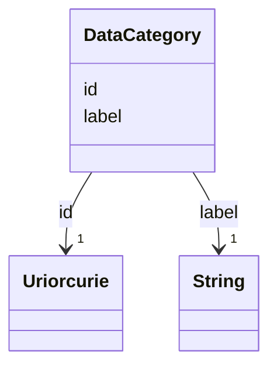

---
search:
  boost: 10.0
---

# Class: DataCategory 


_데이터 분류 (SW입출력 '분류' 드롭다운 값). 연결 계산 키 ① (docs/02 7.1)._


<div data-search-exclude markdown="1">


URI: [eg:DataCategory](http://en-genius.local/onto/DataCategory)





<!-- no inheritance hierarchy -->

## Slots

| Name | Cardinality and Range | Description | Inheritance |
| ---  | --- | --- | --- |
| [id](id.md) | 1 <br/> [xsd:anyURI](http://www.w3.org/2001/XMLSchema#anyURI) | 노드 식별자 | direct |
| [label](label.md) | 1 <br/> [xsd:string](http://www.w3.org/2001/XMLSchema#string) | 사람이 읽는 이름 | direct |


## Usages

| used by | used in | type | used |
| ---  | --- | --- | --- |
| [IOSpec](IOSpec.md) | [io_category](io_category.md) | range | [DataCategory](DataCategory.md) |
| [Feed](Feed.md) | [matched_category](matched_category.md) | range | [DataCategory](DataCategory.md) |


## Identifier and Mapping Information


### Schema Source


* from schema: http://en-genius.local/onto/


## Mappings

| Mapping Type | Mapped Value |
| ---  | ---  |
| self | eg:DataCategory |
| native | eg:DataCategory |


## LinkML Source

<!-- TODO: investigate https://stackoverflow.com/questions/37606292/how-to-create-tabbed-code-blocks-in-mkdocs-or-sphinx -->

### Direct

<details>
```yaml
name: DataCategory
description: 데이터 분류 (SW입출력 '분류' 드롭다운 값). 연결 계산 키 ① (docs/02 7.1).
from_schema: http://en-genius.local/onto/
rank: 1000
slots:
- id
- label
slot_usage:
  id:
    name: id
    pattern: ^egid:CAT-\d{3}$

```
</details>

### Induced

<details>
```yaml
name: DataCategory
description: 데이터 분류 (SW입출력 '분류' 드롭다운 값). 연결 계산 키 ① (docs/02 7.1).
from_schema: http://en-genius.local/onto/
rank: 1000
slot_usage:
  id:
    name: id
    pattern: ^egid:CAT-\d{3}$
attributes:
  id:
    name: id
    description: 노드 식별자. 의미 없는 일련번호 또는 결정적 해시 (docs/02 4장). 예 egid:TOOL-000001
    from_schema: http://en-genius.local/onto/
    rank: 1000
    identifier: true
    owner: DataCategory
    domain_of:
    - ResearchField
    - Tool
    - DataCategory
    - ToolUsage
    - IOSpec
    - Feed
    - SurveyLoad
    range: uriorcurie
    required: true
    pattern: ^egid:CAT-\d{3}$
  label:
    name: label
    description: 사람이 읽는 이름. RDF 에서는 @ko 언어 태그를 붙인다.
    from_schema: http://en-genius.local/onto/
    rank: 1000
    slot_uri: rdfs:label
    owner: DataCategory
    domain_of:
    - ResearchField
    - Tool
    - DataCategory
    - ToolUsage
    - IOSpec
    - Feed
    - SurveyLoad
    range: string
    required: true

```
</details></div>