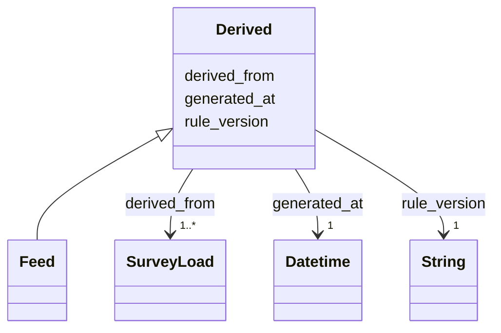

---
search:
  boost: 10.0
---

# Class: Derived 


_규칙으로 계산한 파생 노드의 provenance 묶음 (docs/02 8장). derived 그래프에만 있다._


<div data-search-exclude markdown="1">


URI: [eg:Derived](http://en-genius.local/onto/Derived)





<!-- no inheritance hierarchy -->

## Class Properties

| Property | Value |
| --- | --- |
| Mixin | Yes |


## Slots

| Name | Cardinality and Range | Description | Inheritance |
| ---  | --- | --- | --- |
| [rule_version](rule_version.md) | 1 <br/> [xsd:string](http://www.w3.org/2001/XMLSchema#string) | 이 파생 노드를 만든 규칙 버전 (예 feed_v1) | direct |
| [derived_from](derived_from.md) | 1..* <br/> [SurveyLoad](SurveyLoad.md) | 파생의 근거가 된 적재 기록 (provenance) | direct |
| [generated_at](generated_at.md) | 1 <br/> [xsd:dateTime](http://www.w3.org/2001/XMLSchema#dateTime) | 파생 노드 생성 일시 (provenance) | direct |


## Mixin Usage

| mixed into | description |
| --- | --- |
| [Feed](Feed.md) | (파생) 규칙으로 계산한 공급 연결 — 출력 명세 from_io 와 입력 명세 to_io 의 분류가 같고 정규화 확장자가 겹칠 때 (doc... |


## Identifier and Mapping Information


### Schema Source


* from schema: http://en-genius.local/onto/


## Mappings

| Mapping Type | Mapped Value |
| ---  | ---  |
| self | eg:Derived |
| native | eg:Derived |


## LinkML Source

<!-- TODO: investigate https://stackoverflow.com/questions/37606292/how-to-create-tabbed-code-blocks-in-mkdocs-or-sphinx -->

### Direct

<details>
```yaml
name: Derived
description: 규칙으로 계산한 파생 노드의 provenance 묶음 (docs/02 8장). derived 그래프에만 있다.
from_schema: http://en-genius.local/onto/
rank: 1000
mixin: true
slots:
- rule_version
- derived_from
- generated_at
slot_usage:
  rule_version:
    name: rule_version
    required: true
  derived_from:
    name: derived_from
    required: true
  generated_at:
    name: generated_at
    required: true

```
</details>

### Induced

<details>
```yaml
name: Derived
description: 규칙으로 계산한 파생 노드의 provenance 묶음 (docs/02 8장). derived 그래프에만 있다.
from_schema: http://en-genius.local/onto/
rank: 1000
mixin: true
slot_usage:
  rule_version:
    name: rule_version
    required: true
  derived_from:
    name: derived_from
    required: true
  generated_at:
    name: generated_at
    required: true
attributes:
  rule_version:
    name: rule_version
    description: 이 파생 노드를 만든 규칙 버전 (예 feed_v1).
    from_schema: http://en-genius.local/onto/
    rank: 1000
    owner: Derived
    domain_of:
    - Derived
    range: string
    required: true
  derived_from:
    name: derived_from
    description: 파생의 근거가 된 적재 기록 (provenance).
    from_schema: http://en-genius.local/onto/
    rank: 1000
    slot_uri: prov:wasDerivedFrom
    owner: Derived
    domain_of:
    - Derived
    range: SurveyLoad
    required: true
    multivalued: true
  generated_at:
    name: generated_at
    description: 파생 노드 생성 일시 (provenance).
    from_schema: http://en-genius.local/onto/
    rank: 1000
    slot_uri: prov:generatedAtTime
    owner: Derived
    domain_of:
    - Derived
    range: datetime
    required: true

```
</details></div>