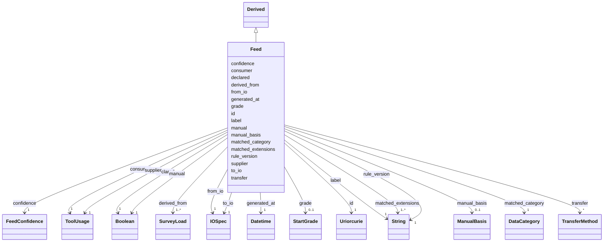

---
search:
  boost: 10.0
---

# Class: Feed 


_(파생) 규칙으로 계산한 공급 연결 — 출력 명세 from_io 와 입력 명세 to_io 의 분류가 같고 정규화 확장자가 겹칠 때 (docs/02 7.1). 매번 전체 재계산하며 derived 그래프에만 있다._


<div data-search-exclude markdown="1">


URI: [eg:Feed](http://en-genius.local/onto/Feed)





## Inheritance
* **Feed** [ [Derived](Derived.md)]


## Slots

| Name | Cardinality and Range | Description | Inheritance |
| ---  | --- | --- | --- |
| [id](id.md) | 1 <br/> [xsd:anyURI](http://www.w3.org/2001/XMLSchema#anyURI) | 노드 식별자 | direct |
| [label](label.md) | 1 <br/> [xsd:string](http://www.w3.org/2001/XMLSchema#string) | 사람이 읽는 이름 | direct |
| [from_io](from_io.md) | 1 <br/> [IOSpec](IOSpec.md) | 공급 측 출력 명세 | direct |
| [to_io](to_io.md) | 1 <br/> [IOSpec](IOSpec.md) | 수요 측 입력 명세 | direct |
| [supplier](supplier.md) | 1 <br/> [ToolUsage](ToolUsage.md) | 공급 측 툴사용 (from_io 의 io_owner) | direct |
| [consumer](consumer.md) | 1 <br/> [ToolUsage](ToolUsage.md) | 수요 측 툴사용 (to_io 의 io_owner) | direct |
| [matched_category](matched_category.md) | 1 <br/> [DataCategory](DataCategory.md) | 양쪽이 일치한 분류 | direct |
| [matched_extensions](matched_extensions.md) | 1..* <br/> [xsd:string](http://www.w3.org/2001/XMLSchema#string) | 양쪽이 겹친 정규화 확장자 | direct |
| [confidence](confidence.md) | 1 <br/> [FeedConfidence](FeedConfidence.md) | 겹친 확장자가 전부 범용(config rules | direct |
| [declared](declared.md) | 1 <br/> [xsd:boolean](http://www.w3.org/2001/XMLSchema#boolean) | 어느 한쪽의 신고(연계 SW명)와 일치하는지 (docs/02 7 | direct |
| [transfer](transfer.md) | * <br/> [TransferMethod](TransferMethod.md) | 양쪽 명세의 전달 방법 | direct |
| [manual](manual.md) | 1 <br/> [xsd:boolean](http://www.w3.org/2001/XMLSchema#boolean) | 수기 구간 여부 (전달 방법 기준) | direct |
| [manual_basis](manual_basis.md) | 0..1 <br/> [ManualBasis](ManualBasis.md) | 수기 판정 근거 — 전달방법, 또는 비고 키워드만 있는 보조 신호 | direct |
| [grade](grade.md) | 0..1 <br/> [StartGrade](StartGrade.md) | 착수 등급 (수기·변환 구간에만 매긴다, docs/02 7 | direct |
| [rule_version](rule_version.md) | 1 <br/> [xsd:string](http://www.w3.org/2001/XMLSchema#string) | 이 파생 노드를 만든 규칙 버전 (예 feed_v1) | [Derived](Derived.md) |
| [derived_from](derived_from.md) | 1..* <br/> [SurveyLoad](SurveyLoad.md) | 파생의 근거가 된 적재 기록 (provenance) | [Derived](Derived.md) |
| [generated_at](generated_at.md) | 1 <br/> [xsd:dateTime](http://www.w3.org/2001/XMLSchema#dateTime) | 파생 노드 생성 일시 (provenance) | [Derived](Derived.md) |


## Identifier and Mapping Information


### Schema Source


* from schema: http://en-genius.local/onto/


## Mappings

| Mapping Type | Mapped Value |
| ---  | ---  |
| self | eg:Feed |
| native | eg:Feed |


## LinkML Source

<!-- TODO: investigate https://stackoverflow.com/questions/37606292/how-to-create-tabbed-code-blocks-in-mkdocs-or-sphinx -->

### Direct

<details>
```yaml
name: Feed
description: (파생) 규칙으로 계산한 공급 연결 — 출력 명세 from_io 와 입력 명세 to_io 의 분류가 같고 정규화 확장자가 겹칠
  때 (docs/02 7.1). 매번 전체 재계산하며 derived 그래프에만 있다.
from_schema: http://en-genius.local/onto/
rank: 1000
mixins:
- Derived
slots:
- id
- label
slot_usage:
  id:
    name: id
    pattern: ^egid:FEED-[0-9a-f]{10}$
attributes:
  from_io:
    name: from_io
    description: 공급 측 출력 명세.
    from_schema: http://en-genius.local/onto/
    rank: 1000
    domain_of:
    - Feed
    range: IOSpec
    required: true
  to_io:
    name: to_io
    description: 수요 측 입력 명세.
    from_schema: http://en-genius.local/onto/
    rank: 1000
    domain_of:
    - Feed
    range: IOSpec
    required: true
  supplier:
    name: supplier
    description: 공급 측 툴사용 (from_io 의 io_owner).
    from_schema: http://en-genius.local/onto/
    rank: 1000
    domain_of:
    - Feed
    range: ToolUsage
    required: true
  consumer:
    name: consumer
    description: 수요 측 툴사용 (to_io 의 io_owner).
    from_schema: http://en-genius.local/onto/
    rank: 1000
    domain_of:
    - Feed
    range: ToolUsage
    required: true
  matched_category:
    name: matched_category
    description: 양쪽이 일치한 분류.
    from_schema: http://en-genius.local/onto/
    rank: 1000
    domain_of:
    - Feed
    range: DataCategory
    required: true
  matched_extensions:
    name: matched_extensions
    description: 양쪽이 겹친 정규화 확장자.
    from_schema: http://en-genius.local/onto/
    rank: 1000
    domain_of:
    - Feed
    required: true
    multivalued: true
  confidence:
    name: confidence
    description: 겹친 확장자가 전부 범용(config rules.yaml generic_extensions)이면 낮음.
    from_schema: http://en-genius.local/onto/
    rank: 1000
    domain_of:
    - Feed
    range: FeedConfidence
    required: true
  declared:
    name: declared
    description: 어느 한쪽의 신고(연계 SW명)와 일치하는지 (docs/02 7.2).
    from_schema: http://en-genius.local/onto/
    rank: 1000
    domain_of:
    - Feed
    range: boolean
    required: true
  transfer:
    name: transfer
    description: 양쪽 명세의 전달 방법.
    from_schema: http://en-genius.local/onto/
    rank: 1000
    domain_of:
    - Feed
    range: TransferMethod
    multivalued: true
  manual:
    name: manual
    description: 수기 구간 여부 (전달 방법 기준).
    from_schema: http://en-genius.local/onto/
    rank: 1000
    domain_of:
    - Feed
    range: boolean
    required: true
  manual_basis:
    name: manual_basis
    description: 수기 판정 근거 — 전달방법, 또는 비고 키워드만 있는 보조 신호.
    from_schema: http://en-genius.local/onto/
    rank: 1000
    domain_of:
    - Feed
    range: ManualBasis
  grade:
    name: grade
    description: 착수 등급 (수기·변환 구간에만 매긴다, docs/02 7.4).
    from_schema: http://en-genius.local/onto/
    rank: 1000
    domain_of:
    - Feed
    range: StartGrade

```
</details>

### Induced

<details>
```yaml
name: Feed
description: (파생) 규칙으로 계산한 공급 연결 — 출력 명세 from_io 와 입력 명세 to_io 의 분류가 같고 정규화 확장자가 겹칠
  때 (docs/02 7.1). 매번 전체 재계산하며 derived 그래프에만 있다.
from_schema: http://en-genius.local/onto/
rank: 1000
mixins:
- Derived
slot_usage:
  id:
    name: id
    pattern: ^egid:FEED-[0-9a-f]{10}$
attributes:
  from_io:
    name: from_io
    description: 공급 측 출력 명세.
    from_schema: http://en-genius.local/onto/
    rank: 1000
    owner: Feed
    domain_of:
    - Feed
    range: IOSpec
    required: true
  to_io:
    name: to_io
    description: 수요 측 입력 명세.
    from_schema: http://en-genius.local/onto/
    rank: 1000
    owner: Feed
    domain_of:
    - Feed
    range: IOSpec
    required: true
  supplier:
    name: supplier
    description: 공급 측 툴사용 (from_io 의 io_owner).
    from_schema: http://en-genius.local/onto/
    rank: 1000
    owner: Feed
    domain_of:
    - Feed
    range: ToolUsage
    required: true
  consumer:
    name: consumer
    description: 수요 측 툴사용 (to_io 의 io_owner).
    from_schema: http://en-genius.local/onto/
    rank: 1000
    owner: Feed
    domain_of:
    - Feed
    range: ToolUsage
    required: true
  matched_category:
    name: matched_category
    description: 양쪽이 일치한 분류.
    from_schema: http://en-genius.local/onto/
    rank: 1000
    owner: Feed
    domain_of:
    - Feed
    range: DataCategory
    required: true
  matched_extensions:
    name: matched_extensions
    description: 양쪽이 겹친 정규화 확장자.
    from_schema: http://en-genius.local/onto/
    rank: 1000
    owner: Feed
    domain_of:
    - Feed
    range: string
    required: true
    multivalued: true
  confidence:
    name: confidence
    description: 겹친 확장자가 전부 범용(config rules.yaml generic_extensions)이면 낮음.
    from_schema: http://en-genius.local/onto/
    rank: 1000
    owner: Feed
    domain_of:
    - Feed
    range: FeedConfidence
    required: true
  declared:
    name: declared
    description: 어느 한쪽의 신고(연계 SW명)와 일치하는지 (docs/02 7.2).
    from_schema: http://en-genius.local/onto/
    rank: 1000
    owner: Feed
    domain_of:
    - Feed
    range: boolean
    required: true
  transfer:
    name: transfer
    description: 양쪽 명세의 전달 방법.
    from_schema: http://en-genius.local/onto/
    rank: 1000
    owner: Feed
    domain_of:
    - Feed
    range: TransferMethod
    multivalued: true
  manual:
    name: manual
    description: 수기 구간 여부 (전달 방법 기준).
    from_schema: http://en-genius.local/onto/
    rank: 1000
    owner: Feed
    domain_of:
    - Feed
    range: boolean
    required: true
  manual_basis:
    name: manual_basis
    description: 수기 판정 근거 — 전달방법, 또는 비고 키워드만 있는 보조 신호.
    from_schema: http://en-genius.local/onto/
    rank: 1000
    owner: Feed
    domain_of:
    - Feed
    range: ManualBasis
  grade:
    name: grade
    description: 착수 등급 (수기·변환 구간에만 매긴다, docs/02 7.4).
    from_schema: http://en-genius.local/onto/
    rank: 1000
    owner: Feed
    domain_of:
    - Feed
    range: StartGrade
  id:
    name: id
    description: 노드 식별자. 의미 없는 일련번호 또는 결정적 해시 (docs/02 4장). 예 egid:TOOL-000001
    from_schema: http://en-genius.local/onto/
    rank: 1000
    identifier: true
    owner: Feed
    domain_of:
    - ResearchField
    - Tool
    - DataCategory
    - ToolUsage
    - IOSpec
    - Feed
    - SurveyLoad
    range: uriorcurie
    required: true
    pattern: ^egid:FEED-[0-9a-f]{10}$
  label:
    name: label
    description: 사람이 읽는 이름. RDF 에서는 @ko 언어 태그를 붙인다.
    from_schema: http://en-genius.local/onto/
    rank: 1000
    slot_uri: rdfs:label
    owner: Feed
    domain_of:
    - ResearchField
    - Tool
    - DataCategory
    - ToolUsage
    - IOSpec
    - Feed
    - SurveyLoad
    range: string
    required: true
  rule_version:
    name: rule_version
    description: 이 파생 노드를 만든 규칙 버전 (예 feed_v1).
    from_schema: http://en-genius.local/onto/
    rank: 1000
    owner: Feed
    domain_of:
    - Derived
    range: string
    required: true
  derived_from:
    name: derived_from
    description: 파생의 근거가 된 적재 기록 (provenance).
    from_schema: http://en-genius.local/onto/
    rank: 1000
    slot_uri: prov:wasDerivedFrom
    owner: Feed
    domain_of:
    - Derived
    range: SurveyLoad
    required: true
    multivalued: true
  generated_at:
    name: generated_at
    description: 파생 노드 생성 일시 (provenance).
    from_schema: http://en-genius.local/onto/
    rank: 1000
    slot_uri: prov:generatedAtTime
    owner: Feed
    domain_of:
    - Derived
    range: datetime
    required: true

```
</details></div>