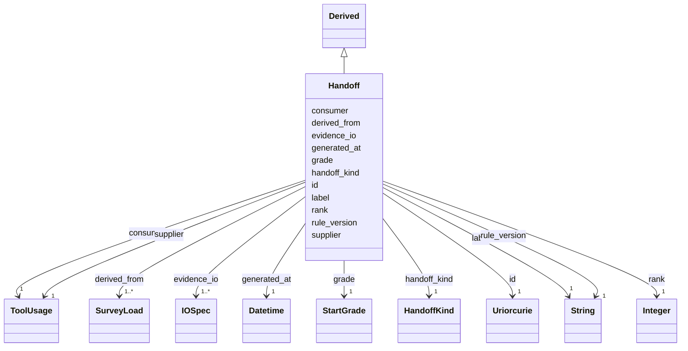

---
search:
  boost: 10.0
---

# Class: Handoff 


_(파생) 착수 구간 1행 (CQ03, docs/02 7.4 — 보고서 '수기구간_착수순위' 시트와 M6 manual_handoffs 의 원천). (공급 툴사용, 수요 툴사용, 종류) 마다 하나이고 근거 입출력을 모두 단다 (골든 I4·I25). 종류: 수기 연결, 변환 구간(숨은변환 의심을 상대 툴의 사용마다 펼친 것 — D1-2), 비고 신호 (골든 I3). D1 은 등급을 Reconciliation 에 두기로 했으나, 펼친 변환 구간마다 등급이 달라(예: CATIA 두 사용이 A·B) 이 클래스로 옮겼다 (M3, docs/07)._


<div data-search-exclude markdown="1">


URI: [eg:Handoff](http://en-genius.local/onto/Handoff)





## Inheritance
* **Handoff** [ [Derived](Derived.md)]


## Slots

| Name | Cardinality and Range | Description | Inheritance |
| ---  | --- | --- | --- |
| [id](id.md) | 1 <br/> [xsd:anyURI](http://www.w3.org/2001/XMLSchema#anyURI) | 노드 식별자 | direct |
| [label](label.md) | 1 <br/> [xsd:string](http://www.w3.org/2001/XMLSchema#string) | 사람이 읽는 이름 | direct |
| [supplier](supplier.md) | 1 <br/> [ToolUsage](ToolUsage.md) | 공급 측 툴사용 (Feed 는 from_io 의 io_owner, Handoff 는 착수 구간의 공급 측) | direct |
| [consumer](consumer.md) | 1 <br/> [ToolUsage](ToolUsage.md) | 수요 측 툴사용 (Feed 는 to_io 의 io_owner, Handoff 는 착수 구간의 수요 측) | direct |
| [grade](grade.md) | 1 <br/> [StartGrade](StartGrade.md) | 착수 등급 (docs/02 7 | direct |
| [handoff_kind](handoff_kind.md) | 1 <br/> [HandoffKind](HandoffKind.md) | 착수 구간 종류 | direct |
| [evidence_io](evidence_io.md) | 1..* <br/> [IOSpec](IOSpec.md) | 근거 입출력 명세 (수기·비고는 Feed 양쪽, 변환은 숨은변환 의심 입출력) | direct |
| [rank](rank.md) | 1 <br/> [xsd:integer](http://www.w3.org/2001/XMLSchema#integer) | 착수 순위 (1부터 — docs/02 7 | direct |
| [rule_version](rule_version.md) | 1 <br/> [xsd:string](http://www.w3.org/2001/XMLSchema#string) | 이 파생 노드를 만든 규칙 버전 (예 feed_v1) | [Derived](Derived.md) |
| [derived_from](derived_from.md) | 1..* <br/> [SurveyLoad](SurveyLoad.md) | 파생의 근거가 된 적재 기록 (provenance) | [Derived](Derived.md) |
| [generated_at](generated_at.md) | 1 <br/> [xsd:dateTime](http://www.w3.org/2001/XMLSchema#dateTime) | 파생 노드 생성 일시 (provenance) | [Derived](Derived.md) |


## Identifier and Mapping Information


### Schema Source


* from schema: http://en-genius.local/onto/


## Mappings

| Mapping Type | Mapped Value |
| ---  | ---  |
| self | eg:Handoff |
| native | eg:Handoff |


## LinkML Source

<!-- TODO: investigate https://stackoverflow.com/questions/37606292/how-to-create-tabbed-code-blocks-in-mkdocs-or-sphinx -->

### Direct

<details>
```yaml
name: Handoff
description: '(파생) 착수 구간 1행 (CQ03, docs/02 7.4 — 보고서 ''수기구간_착수순위'' 시트와 M6 manual_handoffs
  의 원천). (공급 툴사용, 수요 툴사용, 종류) 마다 하나이고 근거 입출력을 모두 단다 (골든 I4·I25). 종류: 수기 연결, 변환 구간(숨은변환
  의심을 상대 툴의 사용마다 펼친 것 — D1-2), 비고 신호 (골든 I3). D1 은 등급을 Reconciliation 에 두기로 했으나, 펼친
  변환 구간마다 등급이 달라(예: CATIA 두 사용이 A·B) 이 클래스로 옮겼다 (M3, docs/07).'
from_schema: http://en-genius.local/onto/
rank: 1000
mixins:
- Derived
slots:
- id
- label
- supplier
- consumer
- grade
slot_usage:
  id:
    name: id
    pattern: ^egid:HANDOFF-[0-9a-f]{10}$
  supplier:
    name: supplier
    required: true
  consumer:
    name: consumer
    required: true
  grade:
    name: grade
    required: true
attributes:
  handoff_kind:
    name: handoff_kind
    description: 착수 구간 종류.
    from_schema: http://en-genius.local/onto/
    rank: 1000
    domain_of:
    - Handoff
    range: HandoffKind
    required: true
  evidence_io:
    name: evidence_io
    description: 근거 입출력 명세 (수기·비고는 Feed 양쪽, 변환은 숨은변환 의심 입출력).
    from_schema: http://en-genius.local/onto/
    rank: 1000
    domain_of:
    - Handoff
    range: IOSpec
    required: true
    multivalued: true
  rank:
    name: rank
    description: 착수 순위 (1부터 — docs/02 7.4 정렬, 골든 I5·I6·I18).
    from_schema: http://en-genius.local/onto/
    rank: 1000
    domain_of:
    - Handoff
    range: integer
    required: true
    minimum_value: 1

```
</details>

### Induced

<details>
```yaml
name: Handoff
description: '(파생) 착수 구간 1행 (CQ03, docs/02 7.4 — 보고서 ''수기구간_착수순위'' 시트와 M6 manual_handoffs
  의 원천). (공급 툴사용, 수요 툴사용, 종류) 마다 하나이고 근거 입출력을 모두 단다 (골든 I4·I25). 종류: 수기 연결, 변환 구간(숨은변환
  의심을 상대 툴의 사용마다 펼친 것 — D1-2), 비고 신호 (골든 I3). D1 은 등급을 Reconciliation 에 두기로 했으나, 펼친
  변환 구간마다 등급이 달라(예: CATIA 두 사용이 A·B) 이 클래스로 옮겼다 (M3, docs/07).'
from_schema: http://en-genius.local/onto/
rank: 1000
mixins:
- Derived
slot_usage:
  id:
    name: id
    pattern: ^egid:HANDOFF-[0-9a-f]{10}$
  supplier:
    name: supplier
    required: true
  consumer:
    name: consumer
    required: true
  grade:
    name: grade
    required: true
attributes:
  handoff_kind:
    name: handoff_kind
    description: 착수 구간 종류.
    from_schema: http://en-genius.local/onto/
    rank: 1000
    owner: Handoff
    domain_of:
    - Handoff
    range: HandoffKind
    required: true
  evidence_io:
    name: evidence_io
    description: 근거 입출력 명세 (수기·비고는 Feed 양쪽, 변환은 숨은변환 의심 입출력).
    from_schema: http://en-genius.local/onto/
    rank: 1000
    owner: Handoff
    domain_of:
    - Handoff
    range: IOSpec
    required: true
    multivalued: true
  rank:
    name: rank
    description: 착수 순위 (1부터 — docs/02 7.4 정렬, 골든 I5·I6·I18).
    from_schema: http://en-genius.local/onto/
    rank: 1000
    owner: Handoff
    domain_of:
    - Handoff
    range: integer
    required: true
    minimum_value: 1
  id:
    name: id
    description: 노드 식별자. 의미 없는 일련번호 또는 결정적 해시 (docs/02 4장). 예 egid:TOOL-000001
    from_schema: http://en-genius.local/onto/
    rank: 1000
    identifier: true
    owner: Handoff
    domain_of:
    - ResearchField
    - Tool
    - DataCategory
    - ToolUsage
    - IOSpec
    - Feed
    - Reconciliation
    - IsolationFinding
    - Handoff
    - SurveyLoad
    range: uriorcurie
    required: true
    pattern: ^egid:HANDOFF-[0-9a-f]{10}$
  label:
    name: label
    description: 사람이 읽는 이름. RDF 에서는 @ko 언어 태그를 붙인다.
    from_schema: http://en-genius.local/onto/
    rank: 1000
    slot_uri: rdfs:label
    owner: Handoff
    domain_of:
    - ResearchField
    - Tool
    - DataCategory
    - ToolUsage
    - IOSpec
    - Feed
    - Reconciliation
    - IsolationFinding
    - Handoff
    - SurveyLoad
    range: string
    required: true
  supplier:
    name: supplier
    description: 공급 측 툴사용 (Feed 는 from_io 의 io_owner, Handoff 는 착수 구간의 공급 측).
    from_schema: http://en-genius.local/onto/
    rank: 1000
    owner: Handoff
    domain_of:
    - Feed
    - Handoff
    range: ToolUsage
    required: true
  consumer:
    name: consumer
    description: 수요 측 툴사용 (Feed 는 to_io 의 io_owner, Handoff 는 착수 구간의 수요 측).
    from_schema: http://en-genius.local/onto/
    rank: 1000
    owner: Handoff
    domain_of:
    - Feed
    - Handoff
    range: ToolUsage
    required: true
  grade:
    name: grade
    description: 착수 등급 (docs/02 7.4) — 공급·수요 툴사용의 자동화 가능 여부와 폐쇄망 구동으로 정한다.
    from_schema: http://en-genius.local/onto/
    rank: 1000
    owner: Handoff
    domain_of:
    - Feed
    - Handoff
    range: StartGrade
    required: true
  rule_version:
    name: rule_version
    description: 이 파생 노드를 만든 규칙 버전 (예 feed_v1).
    from_schema: http://en-genius.local/onto/
    rank: 1000
    owner: Handoff
    domain_of:
    - Derived
    range: string
    required: true
  derived_from:
    name: derived_from
    description: 파생의 근거가 된 적재 기록 (provenance).
    from_schema: http://en-genius.local/onto/
    rank: 1000
    slot_uri: prov:wasDerivedFrom
    owner: Handoff
    domain_of:
    - Derived
    range: SurveyLoad
    required: true
    multivalued: true
  generated_at:
    name: generated_at
    description: 파생 노드 생성 일시 (provenance).
    from_schema: http://en-genius.local/onto/
    rank: 1000
    slot_uri: prov:generatedAtTime
    owner: Handoff
    domain_of:
    - Derived
    range: datetime
    required: true

```
</details></div>