---
search:
  boost: 10.0
---

# Class: IOSpec 


_SW입출력 1행. 한 툴사용이 받거나(입력) 내놓는(출력) 데이터 1종 — 에이전트 단계에서 MCP 함수의 입력·출력 정의가 된다 (docs/01 원칙 6)._


<div data-search-exclude markdown="1">


URI: [eg:IOSpec](http://en-genius.local/onto/IOSpec)

```mermaid
 classDiagram
    class IOSpec
    click IOSpec href "../IOSpec/"
      IOSpec : data_name
        
          
    
        
        
        IOSpec --> "1" String : data_name
        click String href "../http://www.w3.org/2001/XMLSchema#string/"
    

        
      IOSpec : data_nature
        
          
    
        
        
        IOSpec --> "1" DataNature : data_nature
        click DataNature href "../DataNature/"
    

        
      IOSpec : direction
        
          
    
        
        
        IOSpec --> "1" IODirection : direction
        click IODirection href "../IODirection/"
    

        
      IOSpec : extensions
        
          
    
        
        
        IOSpec --> "*" String : extensions
        click String href "../http://www.w3.org/2001/XMLSchema#string/"
    

        
      IOSpec : extensions_raw
        
          
    
        
        
        IOSpec --> "1" String : extensions_raw
        click String href "../http://www.w3.org/2001/XMLSchema#string/"
    

        
      IOSpec : format_standard
        
          
    
        
        
        IOSpec --> "0..1" FormatStandard : format_standard
        click FormatStandard href "../FormatStandard/"
    

        
      IOSpec : id
        
          
    
        
        
        IOSpec --> "1" Uriorcurie : id
        click Uriorcurie href "../http://www.w3.org/2001/XMLSchema#anyURI/"
    

        
      IOSpec : inhouse_format
        
          
    
        
        
        IOSpec --> "0..1" Boolean : inhouse_format
        click Boolean href "../http://www.w3.org/2001/XMLSchema#boolean/"
    

        
      IOSpec : io_category
        
          
    
        
        
        IOSpec --> "1" DataCategory : io_category
        click DataCategory href "../DataCategory/"
    

        
      IOSpec : io_owner
        
          
    
        
        
        IOSpec --> "0..1" ToolUsage : io_owner
        click ToolUsage href "../ToolUsage/"
    

        
      IOSpec : label
        
          
    
        
        
        IOSpec --> "1" String : label
        click String href "../http://www.w3.org/2001/XMLSchema#string/"
    

        
      IOSpec : loaded_in
        
          
    
        
        
        IOSpec --> "0..1" SurveyLoad : loaded_in
        click SurveyLoad href "../SurveyLoad/"
    

        
      IOSpec : note
        
          
    
        
        
        IOSpec --> "0..1" String : note
        click String href "../http://www.w3.org/2001/XMLSchema#string/"
    

        
      IOSpec : owner_source_key
        
          
    
        
        
        IOSpec --> "1" String : owner_source_key
        click String href "../http://www.w3.org/2001/XMLSchema#string/"
    

        
      IOSpec : partner_raw
        
          
    
        
        
        IOSpec --> "0..1" String : partner_raw
        click String href "../http://www.w3.org/2001/XMLSchema#string/"
    

        
      IOSpec : partner_tools
        
          
    
        
        
        IOSpec --> "*" Tool : partner_tools
        click Tool href "../Tool/"
    

        
      IOSpec : partner_unresolved
        
          
    
        
        
        IOSpec --> "*" String : partner_unresolved
        click String href "../http://www.w3.org/2001/XMLSchema#string/"
    

        
      IOSpec : security_grade
        
          
    
        
        
        IOSpec --> "0..1" SecurityGrade : security_grade
        click SecurityGrade href "../SecurityGrade/"
    

        
      IOSpec : source_row
        
          
    
        
        
        IOSpec --> "0..1" Integer : source_row
        click Integer href "../http://www.w3.org/2001/XMLSchema#integer/"
    

        
      IOSpec : storage_path
        
          
    
        
        
        IOSpec --> "0..1" String : storage_path
        click String href "../http://www.w3.org/2001/XMLSchema#string/"
    

        
      IOSpec : transfer_method
        
          
    
        
        
        IOSpec --> "1" TransferMethod : transfer_method
        click TransferMethod href "../TransferMethod/"
    

        
      
```





<!-- no inheritance hierarchy -->

## Slots

| Name | Cardinality and Range | Description | Inheritance |
| ---  | --- | --- | --- |
| [id](id.md) | 1 <br/> [xsd:anyURI](http://www.w3.org/2001/XMLSchema#anyURI) | 노드 식별자 | direct |
| [label](label.md) | 1 <br/> [xsd:string](http://www.w3.org/2001/XMLSchema#string) | 데이터/산출물 명칭 (data_name 과 같게 둔다) | direct |
| [source_row](source_row.md) | 0..1 <br/> [xsd:integer](http://www.w3.org/2001/XMLSchema#integer) | 원천 엑셀 시트의 행 번호 (조사 보완 시 원본 행을 찾기 위한 추적 정보) | direct |
| [loaded_in](loaded_in.md) | 0..1 <br/> [SurveyLoad](SurveyLoad.md) | 이 노드를 만든 적재 기록 (provenance) | direct |
| [note](note.md) | 0..1 <br/> [xsd:string](http://www.w3.org/2001/XMLSchema#string) | 비고 원문 | direct |
| [owner_source_key](owner_source_key.md) | 1 <br/> [xsd:string](http://www.w3.org/2001/XMLSchema#string) | SW ID 원문 | direct |
| [io_owner](io_owner.md) | 0..1 <br/> [ToolUsage](ToolUsage.md) | 이 입출력을 가진 툴사용 (owner_source_key 로 찾은 것) | direct |
| [direction](direction.md) | 1 <br/> [IODirection](IODirection.md) | 방향 — 이 SW 가 받는 것 = 입력(소비), 내놓는 것 = 출력(생산) | direct |
| [data_name](data_name.md) | 1 <br/> [xsd:string](http://www.w3.org/2001/XMLSchema#string) | 데이터/산출물 명칭 원문 | direct |
| [io_category](io_category.md) | 1 <br/> [DataCategory](DataCategory.md) | 분류 | direct |
| [extensions_raw](extensions_raw.md) | 1 <br/> [xsd:string](http://www.w3.org/2001/XMLSchema#string) | 파일 형식/확장자 원문 | direct |
| [extensions](extensions.md) | * <br/> [xsd:string](http://www.w3.org/2001/XMLSchema#string) | 정규화한 확장자 목록 (소문자, 앞의 점·별표 제거, 별칭 적용 — 다중 점 확장자 tar | direct |
| [inhouse_format](inhouse_format.md) | 0..1 <br/> [xsd:boolean](http://www.w3.org/2001/XMLSchema#boolean) | 확장자 원문에 '(사내)'·'사내' 표기가 있었는지 | direct |
| [format_standard](format_standard.md) | 0..1 <br/> [FormatStandard](FormatStandard.md) | 포맷 표준성 | direct |
| [data_nature](data_nature.md) | 1 <br/> [DataNature](DataNature.md) | 데이터 성격 — 서술형은 문서 RAG, 수치는 DB 적재 대상 | direct |
| [transfer_method](transfer_method.md) | 1 <br/> [TransferMethod](TransferMethod.md) | 전달 방법 | direct |
| [partner_raw](partner_raw.md) | 0..1 <br/> [xsd:string](http://www.w3.org/2001/XMLSchema#string) | 연계 SW명 원문 — 신고된 연결 | direct |
| [partner_tools](partner_tools.md) | * <br/> [Tool](Tool.md) | 연계 SW명 중 Tool 로 해석된 것 | direct |
| [partner_unresolved](partner_unresolved.md) | * <br/> [xsd:string](http://www.w3.org/2001/XMLSchema#string) | 연계 SW명 중 Tool 로 해석하지 못한 이름 — 조사 누락 후보 (CQ09) | direct |
| [storage_path](storage_path.md) | 0..1 <br/> [xsd:string](http://www.w3.org/2001/XMLSchema#string) | 저장 위치/경로 원문 (공유폴더 경로, PDM 폴더명) | direct |
| [security_grade](security_grade.md) | 0..1 <br/> [SecurityGrade](SecurityGrade.md) | 보안등급 — 지금은 속성으로만 적재, 접근 통제는 M6 이후 MCP 게이트웨이 (docs/02 11장) | direct |


## Usages

| used by | used in | type | used |
| ---  | --- | --- | --- |
| [Feed](Feed.md) | [from_io](from_io.md) | range | [IOSpec](IOSpec.md) |
| [Feed](Feed.md) | [to_io](to_io.md) | range | [IOSpec](IOSpec.md) |
| [Reconciliation](Reconciliation.md) | [recon_io](recon_io.md) | range | [IOSpec](IOSpec.md) |
| [Handoff](Handoff.md) | [evidence_io](evidence_io.md) | range | [IOSpec](IOSpec.md) |


## Identifier and Mapping Information


### Schema Source


* from schema: http://en-genius.local/onto/


## Mappings

| Mapping Type | Mapped Value |
| ---  | ---  |
| self | eg:IOSpec |
| native | eg:IOSpec |


## LinkML Source

<!-- TODO: investigate https://stackoverflow.com/questions/37606292/how-to-create-tabbed-code-blocks-in-mkdocs-or-sphinx -->

### Direct

<details>
```yaml
name: IOSpec
description: SW입출력 1행. 한 툴사용이 받거나(입력) 내놓는(출력) 데이터 1종 — 에이전트 단계에서 MCP 함수의 입력·출력 정의가
  된다 (docs/01 원칙 6).
from_schema: http://en-genius.local/onto/
rank: 1000
slots:
- id
- label
- source_row
- loaded_in
- note
slot_usage:
  id:
    name: id
    pattern: ^egid:IO-[0-9a-f]{10}$
  label:
    name: label
    description: 데이터/산출물 명칭 (data_name 과 같게 둔다).
  note:
    name: note
    annotations:
      form_sheet:
        tag: form_sheet
        value: SW입출력
      form_header:
        tag: form_header
        value: 비고
      form_column:
        tag: form_column
        value: M
    description: 비고 원문. 수작업 키워드 보조 신호 (docs/02 7.3).
attributes:
  owner_source_key:
    name: owner_source_key
    annotations:
      form_sheet:
        tag: form_sheet
        value: SW입출력
      form_header:
        tag: form_header
        value: SW ID *
      form_column:
        tag: form_column
        value: A
    description: SW ID 원문. SW기본정보에 없으면 고아 입출력 — io_owner 없이 적재하고 경고.
    from_schema: http://en-genius.local/onto/
    rank: 1000
    domain_of:
    - IOSpec
    required: true
  io_owner:
    name: io_owner
    description: 이 입출력을 가진 툴사용 (owner_source_key 로 찾은 것).
    from_schema: http://en-genius.local/onto/
    rank: 1000
    domain_of:
    - IOSpec
    range: ToolUsage
  direction:
    name: direction
    annotations:
      form_sheet:
        tag: form_sheet
        value: SW입출력
      form_header:
        tag: form_header
        value: 방향 *
      form_column:
        tag: form_column
        value: C
    description: 방향 — 이 SW 가 받는 것 = 입력(소비), 내놓는 것 = 출력(생산).
    from_schema: http://en-genius.local/onto/
    rank: 1000
    domain_of:
    - IOSpec
    range: IODirection
    required: true
  data_name:
    name: data_name
    annotations:
      form_sheet:
        tag: form_sheet
        value: SW입출력
      form_header:
        tag: form_header
        value: 데이터/산출물 명칭 *
      form_column:
        tag: form_column
        value: D
    description: 데이터/산출물 명칭 원문. 표기가 제각각이라 연결 키로 쓰지 않는다 (docs/01 원칙 3).
    from_schema: http://en-genius.local/onto/
    rank: 1000
    domain_of:
    - IOSpec
    required: true
  io_category:
    name: io_category
    annotations:
      form_sheet:
        tag: form_sheet
        value: SW입출력
      form_header:
        tag: form_header
        value: 분류 *
      form_column:
        tag: form_column
        value: E
      form_list:
        tag: form_list
        value: 온톨로지분류
    description: 분류. 연결 계산 키 ①.
    from_schema: http://en-genius.local/onto/
    rank: 1000
    domain_of:
    - IOSpec
    range: DataCategory
    required: true
  extensions_raw:
    name: extensions_raw
    annotations:
      form_sheet:
        tag: form_sheet
        value: SW입출력
      form_header:
        tag: form_header
        value: 파일 형식/확장자 *
      form_column:
        tag: form_column
        value: F
    description: 파일 형식/확장자 원문.
    from_schema: http://en-genius.local/onto/
    rank: 1000
    domain_of:
    - IOSpec
    required: true
  extensions:
    name: extensions
    description: 정규화한 확장자 목록 (소문자, 앞의 점·별표 제거, 별칭 적용 — 다중 점 확장자 tar.gz 허용). 연결 계산
      키 ② (docs/02 6.2). 매핑하지 못한 표기는 넣지 않고 extensions_raw 원문 + 경고.
    from_schema: http://en-genius.local/onto/
    rank: 1000
    domain_of:
    - IOSpec
    multivalued: true
    pattern: ^[a-z0-9_+\-]+(\.[a-z0-9_+\-]+)*$
  inhouse_format:
    name: inhouse_format
    description: 확장자 원문에 '(사내)'·'사내' 표기가 있었는지.
    from_schema: http://en-genius.local/onto/
    rank: 1000
    domain_of:
    - IOSpec
    range: boolean
  format_standard:
    name: format_standard
    annotations:
      form_sheet:
        tag: form_sheet
        value: SW입출력
      form_header:
        tag: form_header
        value: 포맷 표준성
      form_column:
        tag: form_column
        value: G
    description: 포맷 표준성.
    from_schema: http://en-genius.local/onto/
    rank: 1000
    domain_of:
    - IOSpec
    range: FormatStandard
  data_nature:
    name: data_nature
    annotations:
      form_sheet:
        tag: form_sheet
        value: SW입출력
      form_header:
        tag: form_header
        value: 데이터 성격 *
      form_column:
        tag: form_column
        value: H
    description: 데이터 성격 — 서술형은 문서 RAG, 수치는 DB 적재 대상.
    from_schema: http://en-genius.local/onto/
    rank: 1000
    domain_of:
    - IOSpec
    range: DataNature
    required: true
  transfer_method:
    name: transfer_method
    annotations:
      form_sheet:
        tag: form_sheet
        value: SW입출력
      form_header:
        tag: form_header
        value: 전달 방법 *
      form_column:
        tag: form_column
        value: I
    description: 전달 방법. '메일·수기 전달'이면 수기 구간 (docs/02 7.3).
    from_schema: http://en-genius.local/onto/
    rank: 1000
    domain_of:
    - IOSpec
    range: TransferMethod
    required: true
  partner_raw:
    name: partner_raw
    annotations:
      form_sheet:
        tag: form_sheet
        value: SW입출력
      form_header:
        tag: form_header
        value: 연계 SW명
      form_column:
        tag: form_column
        value: J
    description: 연계 SW명 원문 — 신고된 연결.
    from_schema: http://en-genius.local/onto/
    rank: 1000
    domain_of:
    - IOSpec
  partner_tools:
    name: partner_tools
    description: 연계 SW명 중 Tool 로 해석된 것.
    from_schema: http://en-genius.local/onto/
    rank: 1000
    domain_of:
    - IOSpec
    range: Tool
    multivalued: true
  partner_unresolved:
    name: partner_unresolved
    description: 연계 SW명 중 Tool 로 해석하지 못한 이름 — 조사 누락 후보 (CQ09). 원문은 partner_raw 에 있으므로
      여기에는 툴 통합과 같은 정규화 키를 넣는다 (SPARQL 로는 정규화를 재현할 수 없어 원문을 넣으면 표기 변형이 서로 다른 후보로 쪼개진다
      — M1 검토).
    from_schema: http://en-genius.local/onto/
    rank: 1000
    domain_of:
    - IOSpec
    multivalued: true
  storage_path:
    name: storage_path
    annotations:
      form_sheet:
        tag: form_sheet
        value: SW입출력
      form_header:
        tag: form_header
        value: 저장 위치/경로
      form_column:
        tag: form_column
        value: K
    description: 저장 위치/경로 원문 (공유폴더 경로, PDM 폴더명).
    from_schema: http://en-genius.local/onto/
    rank: 1000
    domain_of:
    - IOSpec
  security_grade:
    name: security_grade
    annotations:
      form_sheet:
        tag: form_sheet
        value: SW입출력
      form_header:
        tag: form_header
        value: 보안등급
      form_column:
        tag: form_column
        value: L
    description: 보안등급 — 지금은 속성으로만 적재, 접근 통제는 M6 이후 MCP 게이트웨이 (docs/02 11장).
    from_schema: http://en-genius.local/onto/
    rank: 1000
    domain_of:
    - IOSpec
    range: SecurityGrade

```
</details>

### Induced

<details>
```yaml
name: IOSpec
description: SW입출력 1행. 한 툴사용이 받거나(입력) 내놓는(출력) 데이터 1종 — 에이전트 단계에서 MCP 함수의 입력·출력 정의가
  된다 (docs/01 원칙 6).
from_schema: http://en-genius.local/onto/
rank: 1000
slot_usage:
  id:
    name: id
    pattern: ^egid:IO-[0-9a-f]{10}$
  label:
    name: label
    description: 데이터/산출물 명칭 (data_name 과 같게 둔다).
  note:
    name: note
    annotations:
      form_sheet:
        tag: form_sheet
        value: SW입출력
      form_header:
        tag: form_header
        value: 비고
      form_column:
        tag: form_column
        value: M
    description: 비고 원문. 수작업 키워드 보조 신호 (docs/02 7.3).
attributes:
  owner_source_key:
    name: owner_source_key
    annotations:
      form_sheet:
        tag: form_sheet
        value: SW입출력
      form_header:
        tag: form_header
        value: SW ID *
      form_column:
        tag: form_column
        value: A
    description: SW ID 원문. SW기본정보에 없으면 고아 입출력 — io_owner 없이 적재하고 경고.
    from_schema: http://en-genius.local/onto/
    rank: 1000
    owner: IOSpec
    domain_of:
    - IOSpec
    range: string
    required: true
  io_owner:
    name: io_owner
    description: 이 입출력을 가진 툴사용 (owner_source_key 로 찾은 것).
    from_schema: http://en-genius.local/onto/
    rank: 1000
    owner: IOSpec
    domain_of:
    - IOSpec
    range: ToolUsage
  direction:
    name: direction
    annotations:
      form_sheet:
        tag: form_sheet
        value: SW입출력
      form_header:
        tag: form_header
        value: 방향 *
      form_column:
        tag: form_column
        value: C
    description: 방향 — 이 SW 가 받는 것 = 입력(소비), 내놓는 것 = 출력(생산).
    from_schema: http://en-genius.local/onto/
    rank: 1000
    owner: IOSpec
    domain_of:
    - IOSpec
    range: IODirection
    required: true
  data_name:
    name: data_name
    annotations:
      form_sheet:
        tag: form_sheet
        value: SW입출력
      form_header:
        tag: form_header
        value: 데이터/산출물 명칭 *
      form_column:
        tag: form_column
        value: D
    description: 데이터/산출물 명칭 원문. 표기가 제각각이라 연결 키로 쓰지 않는다 (docs/01 원칙 3).
    from_schema: http://en-genius.local/onto/
    rank: 1000
    owner: IOSpec
    domain_of:
    - IOSpec
    range: string
    required: true
  io_category:
    name: io_category
    annotations:
      form_sheet:
        tag: form_sheet
        value: SW입출력
      form_header:
        tag: form_header
        value: 분류 *
      form_column:
        tag: form_column
        value: E
      form_list:
        tag: form_list
        value: 온톨로지분류
    description: 분류. 연결 계산 키 ①.
    from_schema: http://en-genius.local/onto/
    rank: 1000
    owner: IOSpec
    domain_of:
    - IOSpec
    range: DataCategory
    required: true
  extensions_raw:
    name: extensions_raw
    annotations:
      form_sheet:
        tag: form_sheet
        value: SW입출력
      form_header:
        tag: form_header
        value: 파일 형식/확장자 *
      form_column:
        tag: form_column
        value: F
    description: 파일 형식/확장자 원문.
    from_schema: http://en-genius.local/onto/
    rank: 1000
    owner: IOSpec
    domain_of:
    - IOSpec
    range: string
    required: true
  extensions:
    name: extensions
    description: 정규화한 확장자 목록 (소문자, 앞의 점·별표 제거, 별칭 적용 — 다중 점 확장자 tar.gz 허용). 연결 계산
      키 ② (docs/02 6.2). 매핑하지 못한 표기는 넣지 않고 extensions_raw 원문 + 경고.
    from_schema: http://en-genius.local/onto/
    rank: 1000
    owner: IOSpec
    domain_of:
    - IOSpec
    range: string
    multivalued: true
    pattern: ^[a-z0-9_+\-]+(\.[a-z0-9_+\-]+)*$
  inhouse_format:
    name: inhouse_format
    description: 확장자 원문에 '(사내)'·'사내' 표기가 있었는지.
    from_schema: http://en-genius.local/onto/
    rank: 1000
    owner: IOSpec
    domain_of:
    - IOSpec
    range: boolean
  format_standard:
    name: format_standard
    annotations:
      form_sheet:
        tag: form_sheet
        value: SW입출력
      form_header:
        tag: form_header
        value: 포맷 표준성
      form_column:
        tag: form_column
        value: G
    description: 포맷 표준성.
    from_schema: http://en-genius.local/onto/
    rank: 1000
    owner: IOSpec
    domain_of:
    - IOSpec
    range: FormatStandard
  data_nature:
    name: data_nature
    annotations:
      form_sheet:
        tag: form_sheet
        value: SW입출력
      form_header:
        tag: form_header
        value: 데이터 성격 *
      form_column:
        tag: form_column
        value: H
    description: 데이터 성격 — 서술형은 문서 RAG, 수치는 DB 적재 대상.
    from_schema: http://en-genius.local/onto/
    rank: 1000
    owner: IOSpec
    domain_of:
    - IOSpec
    range: DataNature
    required: true
  transfer_method:
    name: transfer_method
    annotations:
      form_sheet:
        tag: form_sheet
        value: SW입출력
      form_header:
        tag: form_header
        value: 전달 방법 *
      form_column:
        tag: form_column
        value: I
    description: 전달 방법. '메일·수기 전달'이면 수기 구간 (docs/02 7.3).
    from_schema: http://en-genius.local/onto/
    rank: 1000
    owner: IOSpec
    domain_of:
    - IOSpec
    range: TransferMethod
    required: true
  partner_raw:
    name: partner_raw
    annotations:
      form_sheet:
        tag: form_sheet
        value: SW입출력
      form_header:
        tag: form_header
        value: 연계 SW명
      form_column:
        tag: form_column
        value: J
    description: 연계 SW명 원문 — 신고된 연결.
    from_schema: http://en-genius.local/onto/
    rank: 1000
    owner: IOSpec
    domain_of:
    - IOSpec
    range: string
  partner_tools:
    name: partner_tools
    description: 연계 SW명 중 Tool 로 해석된 것.
    from_schema: http://en-genius.local/onto/
    rank: 1000
    owner: IOSpec
    domain_of:
    - IOSpec
    range: Tool
    multivalued: true
  partner_unresolved:
    name: partner_unresolved
    description: 연계 SW명 중 Tool 로 해석하지 못한 이름 — 조사 누락 후보 (CQ09). 원문은 partner_raw 에 있으므로
      여기에는 툴 통합과 같은 정규화 키를 넣는다 (SPARQL 로는 정규화를 재현할 수 없어 원문을 넣으면 표기 변형이 서로 다른 후보로 쪼개진다
      — M1 검토).
    from_schema: http://en-genius.local/onto/
    rank: 1000
    owner: IOSpec
    domain_of:
    - IOSpec
    range: string
    multivalued: true
  storage_path:
    name: storage_path
    annotations:
      form_sheet:
        tag: form_sheet
        value: SW입출력
      form_header:
        tag: form_header
        value: 저장 위치/경로
      form_column:
        tag: form_column
        value: K
    description: 저장 위치/경로 원문 (공유폴더 경로, PDM 폴더명).
    from_schema: http://en-genius.local/onto/
    rank: 1000
    owner: IOSpec
    domain_of:
    - IOSpec
    range: string
  security_grade:
    name: security_grade
    annotations:
      form_sheet:
        tag: form_sheet
        value: SW입출력
      form_header:
        tag: form_header
        value: 보안등급
      form_column:
        tag: form_column
        value: L
    description: 보안등급 — 지금은 속성으로만 적재, 접근 통제는 M6 이후 MCP 게이트웨이 (docs/02 11장).
    from_schema: http://en-genius.local/onto/
    rank: 1000
    owner: IOSpec
    domain_of:
    - IOSpec
    range: SecurityGrade
  id:
    name: id
    description: 노드 식별자. 의미 없는 일련번호 또는 결정적 해시 (docs/02 4장). 예 egid:TOOL-000001
    from_schema: http://en-genius.local/onto/
    rank: 1000
    identifier: true
    owner: IOSpec
    domain_of:
    - ResearchField
    - Tool
    - DataCategory
    - ToolUsage
    - IOSpec
    - Feed
    - Reconciliation
    - IsolationFinding
    - Handoff
    - SurveyLoad
    range: uriorcurie
    required: true
    pattern: ^egid:IO-[0-9a-f]{10}$
  label:
    name: label
    description: 데이터/산출물 명칭 (data_name 과 같게 둔다).
    from_schema: http://en-genius.local/onto/
    rank: 1000
    slot_uri: rdfs:label
    owner: IOSpec
    domain_of:
    - ResearchField
    - Tool
    - DataCategory
    - ToolUsage
    - IOSpec
    - Feed
    - Reconciliation
    - IsolationFinding
    - Handoff
    - SurveyLoad
    range: string
    required: true
  source_row:
    name: source_row
    description: 원천 엑셀 시트의 행 번호 (조사 보완 시 원본 행을 찾기 위한 추적 정보).
    from_schema: http://en-genius.local/onto/
    rank: 1000
    owner: IOSpec
    domain_of:
    - ToolUsage
    - IOSpec
    range: integer
  loaded_in:
    name: loaded_in
    description: 이 노드를 만든 적재 기록 (provenance).
    from_schema: http://en-genius.local/onto/
    rank: 1000
    owner: IOSpec
    domain_of:
    - ToolUsage
    - IOSpec
    range: SurveyLoad
  note:
    name: note
    annotations:
      form_sheet:
        tag: form_sheet
        value: SW입출력
      form_header:
        tag: form_header
        value: 비고
      form_column:
        tag: form_column
        value: M
    description: 비고 원문. 수작업 키워드 보조 신호 (docs/02 7.3).
    from_schema: http://en-genius.local/onto/
    rank: 1000
    owner: IOSpec
    domain_of:
    - ToolUsage
    - IOSpec
    range: string

```
</details></div>