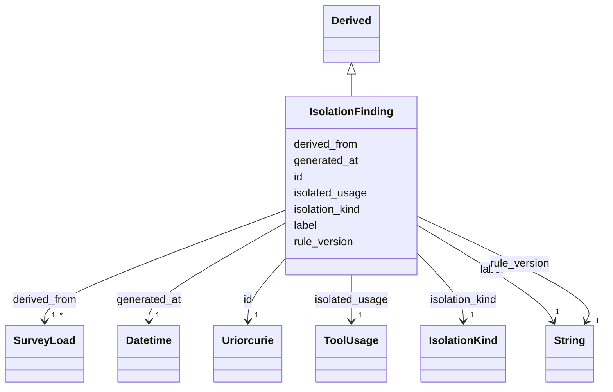

---
search:
  boost: 10.0
---

# Class: IsolationFinding 


_(파생) 고립 툴사용 1건 (CQ05, docs/02 7.5) — 입출력이 없거나, 있어도 연결·해석된 신고 상대가 없음._


<div data-search-exclude markdown="1">


URI: [eg:IsolationFinding](http://en-genius.local/onto/IsolationFinding)





## Inheritance
* **IsolationFinding** [ [Derived](Derived.md)]


## Slots

| Name | Cardinality and Range | Description | Inheritance |
| ---  | --- | --- | --- |
| [id](id.md) | 1 <br/> [xsd:anyURI](http://www.w3.org/2001/XMLSchema#anyURI) | 노드 식별자 | direct |
| [label](label.md) | 1 <br/> [xsd:string](http://www.w3.org/2001/XMLSchema#string) | 사람이 읽는 이름 | direct |
| [isolated_usage](isolated_usage.md) | 1 <br/> [ToolUsage](ToolUsage.md) | 고립된 툴사용 | direct |
| [isolation_kind](isolation_kind.md) | 1 <br/> [IsolationKind](IsolationKind.md) | 고립 유형 (골든 I11) | direct |
| [rule_version](rule_version.md) | 1 <br/> [xsd:string](http://www.w3.org/2001/XMLSchema#string) | 이 파생 노드를 만든 규칙 버전 (예 feed_v1) | [Derived](Derived.md) |
| [derived_from](derived_from.md) | 1..* <br/> [SurveyLoad](SurveyLoad.md) | 파생의 근거가 된 적재 기록 (provenance) | [Derived](Derived.md) |
| [generated_at](generated_at.md) | 1 <br/> [xsd:dateTime](http://www.w3.org/2001/XMLSchema#dateTime) | 파생 노드 생성 일시 (provenance) | [Derived](Derived.md) |


## Identifier and Mapping Information


### Schema Source


* from schema: http://en-genius.local/onto/


## Mappings

| Mapping Type | Mapped Value |
| ---  | ---  |
| self | eg:IsolationFinding |
| native | eg:IsolationFinding |


## LinkML Source

<!-- TODO: investigate https://stackoverflow.com/questions/37606292/how-to-create-tabbed-code-blocks-in-mkdocs-or-sphinx -->

### Direct

<details>
```yaml
name: IsolationFinding
description: (파생) 고립 툴사용 1건 (CQ05, docs/02 7.5) — 입출력이 없거나, 있어도 연결·해석된 신고 상대가 없음.
from_schema: http://en-genius.local/onto/
rank: 1000
mixins:
- Derived
slots:
- id
- label
slot_usage:
  id:
    name: id
    pattern: ^egid:ISO-[0-9a-f]{10}$
attributes:
  isolated_usage:
    name: isolated_usage
    description: 고립된 툴사용.
    from_schema: http://en-genius.local/onto/
    rank: 1000
    domain_of:
    - IsolationFinding
    range: ToolUsage
    required: true
  isolation_kind:
    name: isolation_kind
    description: 고립 유형 (골든 I11).
    from_schema: http://en-genius.local/onto/
    rank: 1000
    domain_of:
    - IsolationFinding
    range: IsolationKind
    required: true

```
</details>

### Induced

<details>
```yaml
name: IsolationFinding
description: (파생) 고립 툴사용 1건 (CQ05, docs/02 7.5) — 입출력이 없거나, 있어도 연결·해석된 신고 상대가 없음.
from_schema: http://en-genius.local/onto/
rank: 1000
mixins:
- Derived
slot_usage:
  id:
    name: id
    pattern: ^egid:ISO-[0-9a-f]{10}$
attributes:
  isolated_usage:
    name: isolated_usage
    description: 고립된 툴사용.
    from_schema: http://en-genius.local/onto/
    rank: 1000
    owner: IsolationFinding
    domain_of:
    - IsolationFinding
    range: ToolUsage
    required: true
  isolation_kind:
    name: isolation_kind
    description: 고립 유형 (골든 I11).
    from_schema: http://en-genius.local/onto/
    rank: 1000
    owner: IsolationFinding
    domain_of:
    - IsolationFinding
    range: IsolationKind
    required: true
  id:
    name: id
    description: 노드 식별자. 의미 없는 일련번호 또는 결정적 해시 (docs/02 4장). 예 egid:TOOL-000001
    from_schema: http://en-genius.local/onto/
    rank: 1000
    identifier: true
    owner: IsolationFinding
    domain_of:
    - ResearchField
    - Tool
    - DataCategory
    - ToolUsage
    - IOSpec
    - Feed
    - Reconciliation
    - IsolationFinding
    - Handoff
    - SurveyLoad
    range: uriorcurie
    required: true
    pattern: ^egid:ISO-[0-9a-f]{10}$
  label:
    name: label
    description: 사람이 읽는 이름. RDF 에서는 @ko 언어 태그를 붙인다.
    from_schema: http://en-genius.local/onto/
    rank: 1000
    slot_uri: rdfs:label
    owner: IsolationFinding
    domain_of:
    - ResearchField
    - Tool
    - DataCategory
    - ToolUsage
    - IOSpec
    - Feed
    - Reconciliation
    - IsolationFinding
    - Handoff
    - SurveyLoad
    range: string
    required: true
  rule_version:
    name: rule_version
    description: 이 파생 노드를 만든 규칙 버전 (예 feed_v1).
    from_schema: http://en-genius.local/onto/
    rank: 1000
    owner: IsolationFinding
    domain_of:
    - Derived
    range: string
    required: true
  derived_from:
    name: derived_from
    description: 파생의 근거가 된 적재 기록 (provenance).
    from_schema: http://en-genius.local/onto/
    rank: 1000
    slot_uri: prov:wasDerivedFrom
    owner: IsolationFinding
    domain_of:
    - Derived
    range: SurveyLoad
    required: true
    multivalued: true
  generated_at:
    name: generated_at
    description: 파생 노드 생성 일시 (provenance).
    from_schema: http://en-genius.local/onto/
    rank: 1000
    slot_uri: prov:generatedAtTime
    owner: IsolationFinding
    domain_of:
    - Derived
    range: datetime
    required: true

```
</details></div>