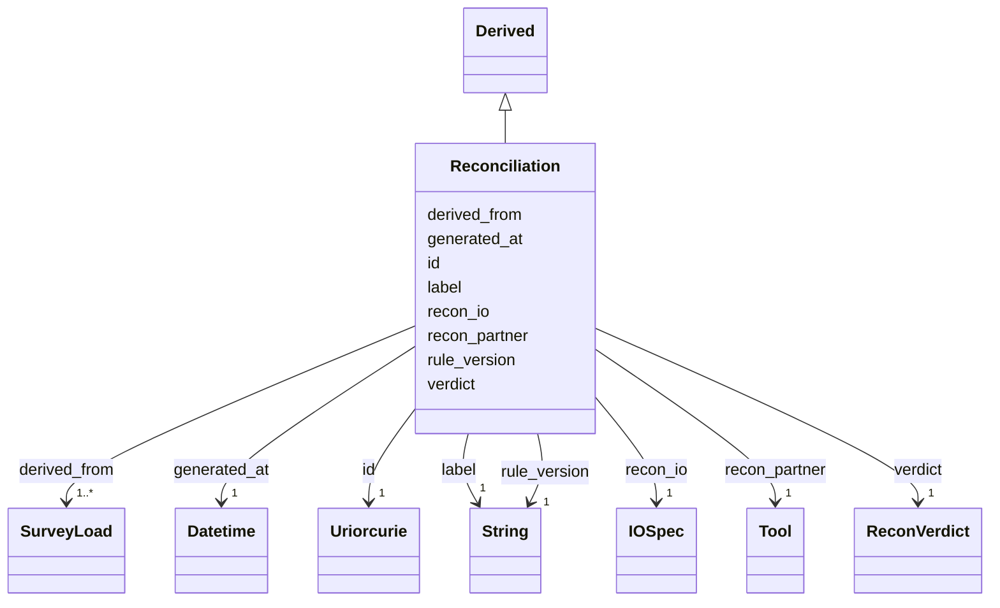

---
search:
  boost: 10.0
---

# Class: Reconciliation 


_(파생) 계산 vs 신고 대조 1건 (CQ04, docs/02 7.2) — 입출력 명세 1개와 상대 툴 1개의 판정. 상대 툴 = 계산된 연결의 상대 ∪ 신고(연계 SW명)에서 해석된 툴. 확장자가 빈 입출력은 신고 상대마다 '확장자 미기재' (골든 I13). 착수 등급은 두지 않는다 — 변환 구간은 상대 툴의 사용마다 펼쳐져 등급이 여럿일 수 있어 Handoff 에 둔다 (D1-2)._


<div data-search-exclude markdown="1">


URI: [eg:Reconciliation](http://en-genius.local/onto/Reconciliation)





## Inheritance
* **Reconciliation** [ [Derived](Derived.md)]


## Slots

| Name | Cardinality and Range | Description | Inheritance |
| ---  | --- | --- | --- |
| [id](id.md) | 1 <br/> [xsd:anyURI](http://www.w3.org/2001/XMLSchema#anyURI) | 노드 식별자 | direct |
| [label](label.md) | 1 <br/> [xsd:string](http://www.w3.org/2001/XMLSchema#string) | 사람이 읽는 이름 | direct |
| [recon_io](recon_io.md) | 1 <br/> [IOSpec](IOSpec.md) | 대조한 입출력 명세 (고아 입출력은 대상 아님 — 골든 I9) | direct |
| [recon_partner](recon_partner.md) | 1 <br/> [Tool](Tool.md) | 대조한 상대 툴 | direct |
| [verdict](verdict.md) | 1 <br/> [ReconVerdict](ReconVerdict.md) | 판정 (docs/02 7 | direct |
| [rule_version](rule_version.md) | 1 <br/> [xsd:string](http://www.w3.org/2001/XMLSchema#string) | 이 파생 노드를 만든 규칙 버전 (예 feed_v1) | [Derived](Derived.md) |
| [derived_from](derived_from.md) | 1..* <br/> [SurveyLoad](SurveyLoad.md) | 파생의 근거가 된 적재 기록 (provenance) | [Derived](Derived.md) |
| [generated_at](generated_at.md) | 1 <br/> [xsd:dateTime](http://www.w3.org/2001/XMLSchema#dateTime) | 파생 노드 생성 일시 (provenance) | [Derived](Derived.md) |


## Identifier and Mapping Information


### Schema Source


* from schema: http://en-genius.local/onto/


## Mappings

| Mapping Type | Mapped Value |
| ---  | ---  |
| self | eg:Reconciliation |
| native | eg:Reconciliation |


## LinkML Source

<!-- TODO: investigate https://stackoverflow.com/questions/37606292/how-to-create-tabbed-code-blocks-in-mkdocs-or-sphinx -->

### Direct

<details>
```yaml
name: Reconciliation
description: (파생) 계산 vs 신고 대조 1건 (CQ04, docs/02 7.2) — 입출력 명세 1개와 상대 툴 1개의 판정. 상대
  툴 = 계산된 연결의 상대 ∪ 신고(연계 SW명)에서 해석된 툴. 확장자가 빈 입출력은 신고 상대마다 '확장자 미기재' (골든 I13). 착수
  등급은 두지 않는다 — 변환 구간은 상대 툴의 사용마다 펼쳐져 등급이 여럿일 수 있어 Handoff 에 둔다 (D1-2).
from_schema: http://en-genius.local/onto/
rank: 1000
mixins:
- Derived
slots:
- id
- label
slot_usage:
  id:
    name: id
    pattern: ^egid:RECON-[0-9a-f]{10}$
attributes:
  recon_io:
    name: recon_io
    description: 대조한 입출력 명세 (고아 입출력은 대상 아님 — 골든 I9).
    from_schema: http://en-genius.local/onto/
    rank: 1000
    domain_of:
    - Reconciliation
    range: IOSpec
    required: true
  recon_partner:
    name: recon_partner
    description: 대조한 상대 툴.
    from_schema: http://en-genius.local/onto/
    rank: 1000
    domain_of:
    - Reconciliation
    range: Tool
    required: true
  verdict:
    name: verdict
    description: 판정 (docs/02 7.2).
    from_schema: http://en-genius.local/onto/
    rank: 1000
    domain_of:
    - Reconciliation
    range: ReconVerdict
    required: true

```
</details>

### Induced

<details>
```yaml
name: Reconciliation
description: (파생) 계산 vs 신고 대조 1건 (CQ04, docs/02 7.2) — 입출력 명세 1개와 상대 툴 1개의 판정. 상대
  툴 = 계산된 연결의 상대 ∪ 신고(연계 SW명)에서 해석된 툴. 확장자가 빈 입출력은 신고 상대마다 '확장자 미기재' (골든 I13). 착수
  등급은 두지 않는다 — 변환 구간은 상대 툴의 사용마다 펼쳐져 등급이 여럿일 수 있어 Handoff 에 둔다 (D1-2).
from_schema: http://en-genius.local/onto/
rank: 1000
mixins:
- Derived
slot_usage:
  id:
    name: id
    pattern: ^egid:RECON-[0-9a-f]{10}$
attributes:
  recon_io:
    name: recon_io
    description: 대조한 입출력 명세 (고아 입출력은 대상 아님 — 골든 I9).
    from_schema: http://en-genius.local/onto/
    rank: 1000
    owner: Reconciliation
    domain_of:
    - Reconciliation
    range: IOSpec
    required: true
  recon_partner:
    name: recon_partner
    description: 대조한 상대 툴.
    from_schema: http://en-genius.local/onto/
    rank: 1000
    owner: Reconciliation
    domain_of:
    - Reconciliation
    range: Tool
    required: true
  verdict:
    name: verdict
    description: 판정 (docs/02 7.2).
    from_schema: http://en-genius.local/onto/
    rank: 1000
    owner: Reconciliation
    domain_of:
    - Reconciliation
    range: ReconVerdict
    required: true
  id:
    name: id
    description: 노드 식별자. 의미 없는 일련번호 또는 결정적 해시 (docs/02 4장). 예 egid:TOOL-000001
    from_schema: http://en-genius.local/onto/
    rank: 1000
    identifier: true
    owner: Reconciliation
    domain_of:
    - ResearchField
    - Tool
    - DataCategory
    - ToolUsage
    - IOSpec
    - Feed
    - Reconciliation
    - IsolationFinding
    - Handoff
    - SurveyLoad
    range: uriorcurie
    required: true
    pattern: ^egid:RECON-[0-9a-f]{10}$
  label:
    name: label
    description: 사람이 읽는 이름. RDF 에서는 @ko 언어 태그를 붙인다.
    from_schema: http://en-genius.local/onto/
    rank: 1000
    slot_uri: rdfs:label
    owner: Reconciliation
    domain_of:
    - ResearchField
    - Tool
    - DataCategory
    - ToolUsage
    - IOSpec
    - Feed
    - Reconciliation
    - IsolationFinding
    - Handoff
    - SurveyLoad
    range: string
    required: true
  rule_version:
    name: rule_version
    description: 이 파생 노드를 만든 규칙 버전 (예 feed_v1).
    from_schema: http://en-genius.local/onto/
    rank: 1000
    owner: Reconciliation
    domain_of:
    - Derived
    range: string
    required: true
  derived_from:
    name: derived_from
    description: 파생의 근거가 된 적재 기록 (provenance).
    from_schema: http://en-genius.local/onto/
    rank: 1000
    slot_uri: prov:wasDerivedFrom
    owner: Reconciliation
    domain_of:
    - Derived
    range: SurveyLoad
    required: true
    multivalued: true
  generated_at:
    name: generated_at
    description: 파생 노드 생성 일시 (provenance).
    from_schema: http://en-genius.local/onto/
    rank: 1000
    slot_uri: prov:generatedAtTime
    owner: Reconciliation
    domain_of:
    - Derived
    range: datetime
    required: true

```
</details></div>