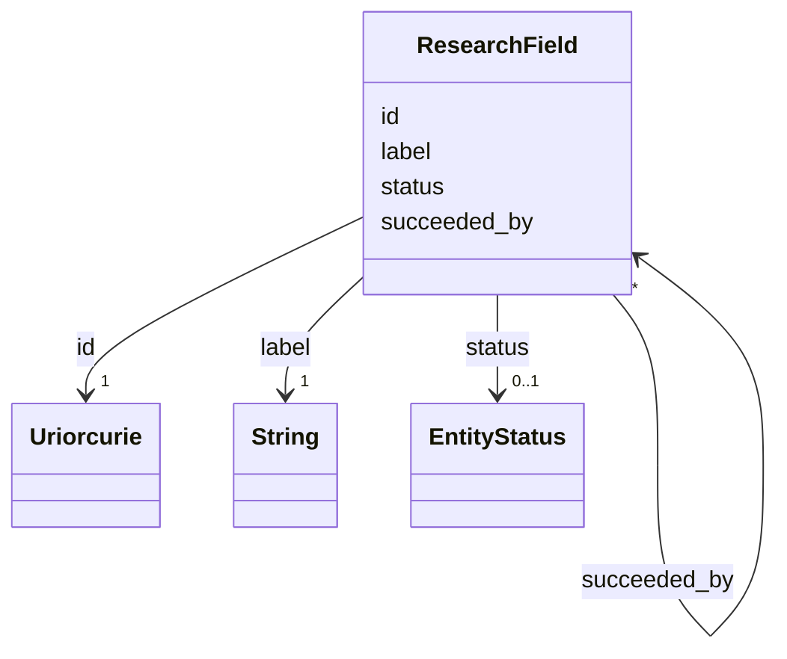

---
search:
  boost: 10.0
---

# Class: ResearchField 


_연구소 분야 (조직 노드, RDF 클래스 eg:Field — docs/02 용어). SW기본정보 '담당 부서' 값에서 만든다. 개명은 label 갱신, 통폐합·분할은 새 노드 + succeeded_by (상위 스키마 v0.2 §9). ID 는 레지스트리로 고정. 스키마·파이썬 이름만 ResearchField — 'Field' 는 생성되는 Pydantic 코드에서 pydantic.Field 를 덮어써 모든 클래스가 깨진다 (M1 에서 실측)._


<div data-search-exclude markdown="1">


URI: [eg:Field](http://en-genius.local/onto/Field)





<!-- no inheritance hierarchy -->

## Class Properties

| Property | Value |
| --- | --- |
| Class URI | [eg:Field](http://en-genius.local/onto/Field) |


## Slots

| Name | Cardinality and Range | Description | Inheritance |
| ---  | --- | --- | --- |
| [id](id.md) | 1 <br/> [xsd:anyURI](http://www.w3.org/2001/XMLSchema#anyURI) | 노드 식별자 | direct |
| [label](label.md) | 1 <br/> [xsd:string](http://www.w3.org/2001/XMLSchema#string) | 사람이 읽는 이름 | direct |
| [status](status.md) | 0..1 <br/> [EntityStatus](EntityStatus.md) | 수명주기 상태 | direct |
| [succeeded_by](succeeded_by.md) | * <br/> [ResearchField](ResearchField.md) | 통폐합·분할로 이 분야를 이어받은 분야 | direct |


## Usages

| used by | used in | type | used |
| ---  | --- | --- | --- |
| [ResearchField](ResearchField.md) | [succeeded_by](succeeded_by.md) | range | [ResearchField](ResearchField.md) |
| [ToolUsage](ToolUsage.md) | [usage_field](usage_field.md) | range | [ResearchField](ResearchField.md) |


## Identifier and Mapping Information


### Schema Source


* from schema: http://en-genius.local/onto/


## Mappings

| Mapping Type | Mapped Value |
| ---  | ---  |
| self | eg:Field |
| native | eg:ResearchField |


## LinkML Source

<!-- TODO: investigate https://stackoverflow.com/questions/37606292/how-to-create-tabbed-code-blocks-in-mkdocs-or-sphinx -->

### Direct

<details>
```yaml
name: ResearchField
description: 연구소 분야 (조직 노드, RDF 클래스 eg:Field — docs/02 용어). SW기본정보 '담당 부서' 값에서 만든다.
  개명은 label 갱신, 통폐합·분할은 새 노드 + succeeded_by (상위 스키마 v0.2 §9). ID 는 레지스트리로 고정. 스키마·파이썬
  이름만 ResearchField — 'Field' 는 생성되는 Pydantic 코드에서 pydantic.Field 를 덮어써 모든 클래스가 깨진다
  (M1 에서 실측).
from_schema: http://en-genius.local/onto/
rank: 1000
slots:
- id
- label
- status
slot_usage:
  id:
    name: id
    pattern: ^egid:FLD-\d{3}$
attributes:
  succeeded_by:
    name: succeeded_by
    description: 통폐합·분할로 이 분야를 이어받은 분야.
    from_schema: http://en-genius.local/onto/
    rank: 1000
    domain_of:
    - ResearchField
    range: ResearchField
    multivalued: true
class_uri: eg:Field

```
</details>

### Induced

<details>
```yaml
name: ResearchField
description: 연구소 분야 (조직 노드, RDF 클래스 eg:Field — docs/02 용어). SW기본정보 '담당 부서' 값에서 만든다.
  개명은 label 갱신, 통폐합·분할은 새 노드 + succeeded_by (상위 스키마 v0.2 §9). ID 는 레지스트리로 고정. 스키마·파이썬
  이름만 ResearchField — 'Field' 는 생성되는 Pydantic 코드에서 pydantic.Field 를 덮어써 모든 클래스가 깨진다
  (M1 에서 실측).
from_schema: http://en-genius.local/onto/
rank: 1000
slot_usage:
  id:
    name: id
    pattern: ^egid:FLD-\d{3}$
attributes:
  succeeded_by:
    name: succeeded_by
    description: 통폐합·분할로 이 분야를 이어받은 분야.
    from_schema: http://en-genius.local/onto/
    rank: 1000
    owner: ResearchField
    domain_of:
    - ResearchField
    range: ResearchField
    multivalued: true
  id:
    name: id
    description: 노드 식별자. 의미 없는 일련번호 또는 결정적 해시 (docs/02 4장). 예 egid:TOOL-000001
    from_schema: http://en-genius.local/onto/
    rank: 1000
    identifier: true
    owner: ResearchField
    domain_of:
    - ResearchField
    - Tool
    - DataCategory
    - ToolUsage
    - IOSpec
    - Feed
    - SurveyLoad
    range: uriorcurie
    required: true
    pattern: ^egid:FLD-\d{3}$
  label:
    name: label
    description: 사람이 읽는 이름. RDF 에서는 @ko 언어 태그를 붙인다.
    from_schema: http://en-genius.local/onto/
    rank: 1000
    slot_uri: rdfs:label
    owner: ResearchField
    domain_of:
    - ResearchField
    - Tool
    - DataCategory
    - ToolUsage
    - IOSpec
    - Feed
    - SurveyLoad
    range: string
    required: true
  status:
    name: status
    description: 수명주기 상태. 삭제하지 않고 상태를 바꾼다 (상위 스키마 v0.2 §6).
    from_schema: http://en-genius.local/onto/
    rank: 1000
    owner: ResearchField
    domain_of:
    - ResearchField
    - Tool
    range: EntityStatus
class_uri: eg:Field

```
</details></div>