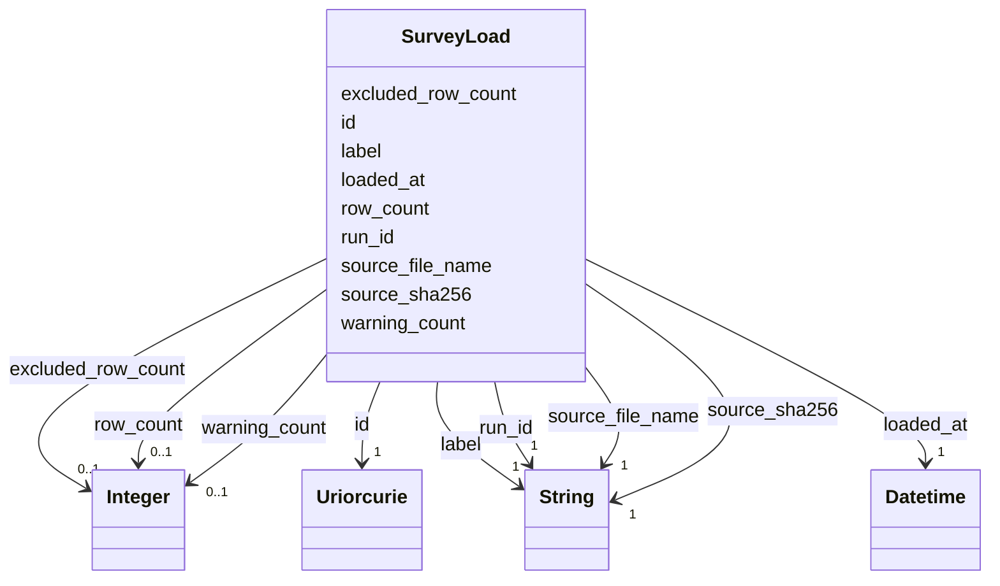

---
search:
  boost: 10.0
---

# Class: SurveyLoad 


_적재 기록 1건 — 원천 조사 파일 1개를 한 번 적재한 것. 같은 실행(run_id)에서 여러 파일을 적재하면 파일마다 1건. 경로는 남기지 않는다 (파일명과 sha256 만)._


<div data-search-exclude markdown="1">


URI: [eg:SurveyLoad](http://en-genius.local/onto/SurveyLoad)





<!-- no inheritance hierarchy -->

## Slots

| Name | Cardinality and Range | Description | Inheritance |
| ---  | --- | --- | --- |
| [id](id.md) | 1 <br/> [xsd:anyURI](http://www.w3.org/2001/XMLSchema#anyURI) | 노드 식별자 | direct |
| [label](label.md) | 1 <br/> [xsd:string](http://www.w3.org/2001/XMLSchema#string) | 사람이 읽는 이름 | direct |
| [run_id](run_id.md) | 1 <br/> [xsd:string](http://www.w3.org/2001/XMLSchema#string) | 적재 실행 ID (output/<실행ID> 와 같다) | direct |
| [source_file_name](source_file_name.md) | 1 <br/> [xsd:string](http://www.w3.org/2001/XMLSchema#string) | 원천 파일명 (경로 제외) | direct |
| [source_sha256](source_sha256.md) | 1 <br/> [xsd:string](http://www.w3.org/2001/XMLSchema#string) | 원천 파일 SHA-256 (소문자 16진수) | direct |
| [loaded_at](loaded_at.md) | 1 <br/> [xsd:dateTime](http://www.w3.org/2001/XMLSchema#dateTime) | 적재 일시 | direct |
| [row_count](row_count.md) | 0..1 <br/> [xsd:integer](http://www.w3.org/2001/XMLSchema#integer) | 적재한 행 수 (두 시트 합) | direct |
| [excluded_row_count](excluded_row_count.md) | 0..1 <br/> [xsd:integer](http://www.w3.org/2001/XMLSchema#integer) | 제외한 행 수 (예시 행·빈 행 등, 사유는 실행 로그) | direct |
| [warning_count](warning_count.md) | 0..1 <br/> [xsd:integer](http://www.w3.org/2001/XMLSchema#integer) | 적재 중 경고 수 (내용은 실행 로그) | direct |


## Usages

| used by | used in | type | used |
| ---  | --- | --- | --- |
| [Derived](Derived.md) | [derived_from](derived_from.md) | range | [SurveyLoad](SurveyLoad.md) |
| [ToolUsage](ToolUsage.md) | [loaded_in](loaded_in.md) | range | [SurveyLoad](SurveyLoad.md) |
| [IOSpec](IOSpec.md) | [loaded_in](loaded_in.md) | range | [SurveyLoad](SurveyLoad.md) |
| [Feed](Feed.md) | [derived_from](derived_from.md) | range | [SurveyLoad](SurveyLoad.md) |


## Identifier and Mapping Information


### Schema Source


* from schema: http://en-genius.local/onto/


## Mappings

| Mapping Type | Mapped Value |
| ---  | ---  |
| self | eg:SurveyLoad |
| native | eg:SurveyLoad |


## LinkML Source

<!-- TODO: investigate https://stackoverflow.com/questions/37606292/how-to-create-tabbed-code-blocks-in-mkdocs-or-sphinx -->

### Direct

<details>
```yaml
name: SurveyLoad
description: 적재 기록 1건 — 원천 조사 파일 1개를 한 번 적재한 것. 같은 실행(run_id)에서 여러 파일을 적재하면 파일마다 1건.
  경로는 남기지 않는다 (파일명과 sha256 만).
from_schema: http://en-genius.local/onto/
rank: 1000
slots:
- id
- label
slot_usage:
  id:
    name: id
    pattern: ^egid:LOAD-\d{8}T\d{6}-\d{2}$
attributes:
  run_id:
    name: run_id
    description: 적재 실행 ID (output/<실행ID> 와 같다).
    from_schema: http://en-genius.local/onto/
    rank: 1000
    domain_of:
    - SurveyLoad
    required: true
  source_file_name:
    name: source_file_name
    description: 원천 파일명 (경로 제외).
    from_schema: http://en-genius.local/onto/
    rank: 1000
    domain_of:
    - SurveyLoad
    required: true
  source_sha256:
    name: source_sha256
    description: 원천 파일 SHA-256 (소문자 16진수).
    from_schema: http://en-genius.local/onto/
    rank: 1000
    domain_of:
    - SurveyLoad
    required: true
    pattern: ^[0-9a-f]{64}$
  loaded_at:
    name: loaded_at
    description: 적재 일시.
    from_schema: http://en-genius.local/onto/
    rank: 1000
    domain_of:
    - SurveyLoad
    range: datetime
    required: true
  row_count:
    name: row_count
    description: 적재한 행 수 (두 시트 합).
    from_schema: http://en-genius.local/onto/
    rank: 1000
    domain_of:
    - SurveyLoad
    range: integer
    minimum_value: 0
  excluded_row_count:
    name: excluded_row_count
    description: 제외한 행 수 (예시 행·빈 행 등, 사유는 실행 로그).
    from_schema: http://en-genius.local/onto/
    rank: 1000
    domain_of:
    - SurveyLoad
    range: integer
    minimum_value: 0
  warning_count:
    name: warning_count
    description: 적재 중 경고 수 (내용은 실행 로그).
    from_schema: http://en-genius.local/onto/
    rank: 1000
    domain_of:
    - SurveyLoad
    range: integer
    minimum_value: 0

```
</details>

### Induced

<details>
```yaml
name: SurveyLoad
description: 적재 기록 1건 — 원천 조사 파일 1개를 한 번 적재한 것. 같은 실행(run_id)에서 여러 파일을 적재하면 파일마다 1건.
  경로는 남기지 않는다 (파일명과 sha256 만).
from_schema: http://en-genius.local/onto/
rank: 1000
slot_usage:
  id:
    name: id
    pattern: ^egid:LOAD-\d{8}T\d{6}-\d{2}$
attributes:
  run_id:
    name: run_id
    description: 적재 실행 ID (output/<실행ID> 와 같다).
    from_schema: http://en-genius.local/onto/
    rank: 1000
    owner: SurveyLoad
    domain_of:
    - SurveyLoad
    range: string
    required: true
  source_file_name:
    name: source_file_name
    description: 원천 파일명 (경로 제외).
    from_schema: http://en-genius.local/onto/
    rank: 1000
    owner: SurveyLoad
    domain_of:
    - SurveyLoad
    range: string
    required: true
  source_sha256:
    name: source_sha256
    description: 원천 파일 SHA-256 (소문자 16진수).
    from_schema: http://en-genius.local/onto/
    rank: 1000
    owner: SurveyLoad
    domain_of:
    - SurveyLoad
    range: string
    required: true
    pattern: ^[0-9a-f]{64}$
  loaded_at:
    name: loaded_at
    description: 적재 일시.
    from_schema: http://en-genius.local/onto/
    rank: 1000
    owner: SurveyLoad
    domain_of:
    - SurveyLoad
    range: datetime
    required: true
  row_count:
    name: row_count
    description: 적재한 행 수 (두 시트 합).
    from_schema: http://en-genius.local/onto/
    rank: 1000
    owner: SurveyLoad
    domain_of:
    - SurveyLoad
    range: integer
    minimum_value: 0
  excluded_row_count:
    name: excluded_row_count
    description: 제외한 행 수 (예시 행·빈 행 등, 사유는 실행 로그).
    from_schema: http://en-genius.local/onto/
    rank: 1000
    owner: SurveyLoad
    domain_of:
    - SurveyLoad
    range: integer
    minimum_value: 0
  warning_count:
    name: warning_count
    description: 적재 중 경고 수 (내용은 실행 로그).
    from_schema: http://en-genius.local/onto/
    rank: 1000
    owner: SurveyLoad
    domain_of:
    - SurveyLoad
    range: integer
    minimum_value: 0
  id:
    name: id
    description: 노드 식별자. 의미 없는 일련번호 또는 결정적 해시 (docs/02 4장). 예 egid:TOOL-000001
    from_schema: http://en-genius.local/onto/
    rank: 1000
    identifier: true
    owner: SurveyLoad
    domain_of:
    - ResearchField
    - Tool
    - DataCategory
    - ToolUsage
    - IOSpec
    - Feed
    - SurveyLoad
    range: uriorcurie
    required: true
    pattern: ^egid:LOAD-\d{8}T\d{6}-\d{2}$
  label:
    name: label
    description: 사람이 읽는 이름. RDF 에서는 @ko 언어 태그를 붙인다.
    from_schema: http://en-genius.local/onto/
    rank: 1000
    slot_uri: rdfs:label
    owner: SurveyLoad
    domain_of:
    - ResearchField
    - Tool
    - DataCategory
    - ToolUsage
    - IOSpec
    - Feed
    - SurveyLoad
    range: string
    required: true

```
</details></div>