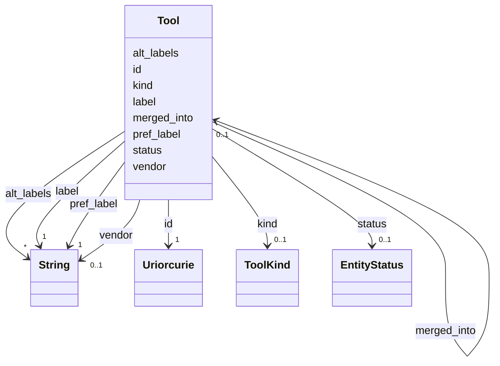

---
search:
  boost: 10.0
---

# Class: Tool 


_제품 단위 툴 (표기 변형을 통합한 것). 예 ANSYS Fluent. 분야별 사용 기록은 ToolUsage. 통합은 정규화 키 일치일 때만 자동, 유사도 후보는 사람이 판정 (docs/02 6.1)._


<div data-search-exclude markdown="1">


URI: [eg:Tool](http://en-genius.local/onto/Tool)





<!-- no inheritance hierarchy -->

## Slots

| Name | Cardinality and Range | Description | Inheritance |
| ---  | --- | --- | --- |
| [id](id.md) | 1 <br/> [xsd:anyURI](http://www.w3.org/2001/XMLSchema#anyURI) | 노드 식별자 | direct |
| [label](label.md) | 1 <br/> [xsd:string](http://www.w3.org/2001/XMLSchema#string) | 사람이 읽는 이름 | direct |
| [status](status.md) | 0..1 <br/> [EntityStatus](EntityStatus.md) | 수명주기 상태 — 삭제하지 않고 상태를 바꾼다 (docs/01 원칙 9) | direct |
| [pref_label](pref_label.md) | 1 <br/> [xsd:string](http://www.w3.org/2001/XMLSchema#string) | 대표 이름 | direct |
| [alt_labels](alt_labels.md) | * <br/> [xsd:string](http://www.w3.org/2001/XMLSchema#string) | 조사에서 나온 변형 표기들 (CQ10) | direct |
| [vendor](vendor.md) | 0..1 <br/> [xsd:string](http://www.w3.org/2001/XMLSchema#string) | 제조사/개발주체 — 사용 기록들의 응답 중 다수값 (엇갈리면 검토표에 표시) | direct |
| [kind](kind.md) | 0..1 <br/> [ToolKind](ToolKind.md) | 구분 — 사용 기록들의 응답 중 다수값 | direct |
| [merged_into](merged_into.md) | 0..1 <br/> [Tool](Tool.md) | 사람 판정으로 다른 Tool 에 통합된 경우 그 대상 (status=통합됨과 함께) | direct |


## Usages

| used by | used in | type | used |
| ---  | --- | --- | --- |
| [Tool](Tool.md) | [merged_into](merged_into.md) | range | [Tool](Tool.md) |
| [ToolUsage](ToolUsage.md) | [usage_tool](usage_tool.md) | range | [Tool](Tool.md) |
| [IOSpec](IOSpec.md) | [partner_tools](partner_tools.md) | range | [Tool](Tool.md) |


## Identifier and Mapping Information


### Schema Source


* from schema: http://en-genius.local/onto/


## Mappings

| Mapping Type | Mapped Value |
| ---  | ---  |
| self | eg:Tool |
| native | eg:Tool |


## LinkML Source

<!-- TODO: investigate https://stackoverflow.com/questions/37606292/how-to-create-tabbed-code-blocks-in-mkdocs-or-sphinx -->

### Direct

<details>
```yaml
name: Tool
description: 제품 단위 툴 (표기 변형을 통합한 것). 예 ANSYS Fluent. 분야별 사용 기록은 ToolUsage. 통합은 정규화
  키 일치일 때만 자동, 유사도 후보는 사람이 판정 (docs/02 6.1).
from_schema: http://en-genius.local/onto/
rank: 1000
slots:
- id
- label
- status
slot_usage:
  id:
    name: id
    pattern: ^egid:TOOL-[0-9]{6}$
attributes:
  pref_label:
    name: pref_label
    description: 대표 이름.
    from_schema: http://en-genius.local/onto/
    rank: 1000
    slot_uri: skos:prefLabel
    domain_of:
    - Tool
    required: true
  alt_labels:
    name: alt_labels
    description: 조사에서 나온 변형 표기들 (CQ10).
    from_schema: http://en-genius.local/onto/
    rank: 1000
    slot_uri: skos:altLabel
    domain_of:
    - Tool
    multivalued: true
  vendor:
    name: vendor
    description: 제조사/개발주체 — 사용 기록들의 응답 중 다수값 (엇갈리면 검토표에 표시).
    from_schema: http://en-genius.local/onto/
    rank: 1000
    domain_of:
    - Tool
  kind:
    name: kind
    description: 구분 — 사용 기록들의 응답 중 다수값.
    from_schema: http://en-genius.local/onto/
    rank: 1000
    domain_of:
    - Tool
    range: ToolKind
  merged_into:
    name: merged_into
    description: 사람 판정으로 다른 Tool 에 통합된 경우 그 대상 (status=통합됨과 함께).
    from_schema: http://en-genius.local/onto/
    rank: 1000
    domain_of:
    - Tool
    range: Tool

```
</details>

### Induced

<details>
```yaml
name: Tool
description: 제품 단위 툴 (표기 변형을 통합한 것). 예 ANSYS Fluent. 분야별 사용 기록은 ToolUsage. 통합은 정규화
  키 일치일 때만 자동, 유사도 후보는 사람이 판정 (docs/02 6.1).
from_schema: http://en-genius.local/onto/
rank: 1000
slot_usage:
  id:
    name: id
    pattern: ^egid:TOOL-[0-9]{6}$
attributes:
  pref_label:
    name: pref_label
    description: 대표 이름.
    from_schema: http://en-genius.local/onto/
    rank: 1000
    slot_uri: skos:prefLabel
    owner: Tool
    domain_of:
    - Tool
    range: string
    required: true
  alt_labels:
    name: alt_labels
    description: 조사에서 나온 변형 표기들 (CQ10).
    from_schema: http://en-genius.local/onto/
    rank: 1000
    slot_uri: skos:altLabel
    owner: Tool
    domain_of:
    - Tool
    range: string
    multivalued: true
  vendor:
    name: vendor
    description: 제조사/개발주체 — 사용 기록들의 응답 중 다수값 (엇갈리면 검토표에 표시).
    from_schema: http://en-genius.local/onto/
    rank: 1000
    owner: Tool
    domain_of:
    - Tool
    range: string
  kind:
    name: kind
    description: 구분 — 사용 기록들의 응답 중 다수값.
    from_schema: http://en-genius.local/onto/
    rank: 1000
    owner: Tool
    domain_of:
    - Tool
    range: ToolKind
  merged_into:
    name: merged_into
    description: 사람 판정으로 다른 Tool 에 통합된 경우 그 대상 (status=통합됨과 함께).
    from_schema: http://en-genius.local/onto/
    rank: 1000
    owner: Tool
    domain_of:
    - Tool
    range: Tool
  id:
    name: id
    description: 노드 식별자. 의미 없는 일련번호 또는 결정적 해시 (docs/02 4장). 예 egid:TOOL-000001
    from_schema: http://en-genius.local/onto/
    rank: 1000
    identifier: true
    owner: Tool
    domain_of:
    - ResearchField
    - Tool
    - DataCategory
    - ToolUsage
    - IOSpec
    - Feed
    - SurveyLoad
    range: uriorcurie
    required: true
    pattern: ^egid:TOOL-[0-9]{6}$
  label:
    name: label
    description: 사람이 읽는 이름. RDF 에서는 @ko 언어 태그를 붙인다.
    from_schema: http://en-genius.local/onto/
    rank: 1000
    slot_uri: rdfs:label
    owner: Tool
    domain_of:
    - ResearchField
    - Tool
    - DataCategory
    - ToolUsage
    - IOSpec
    - Feed
    - SurveyLoad
    range: string
    required: true
  status:
    name: status
    description: 수명주기 상태 — 삭제하지 않고 상태를 바꾼다 (docs/01 원칙 9). 없으면 활성.
    from_schema: http://en-genius.local/onto/
    rank: 1000
    ifabsent: string(활성)
    owner: Tool
    domain_of:
    - ResearchField
    - Tool
    range: EntityStatus

```
</details></div>