---
search:
  boost: 10.0
---

# Class: ToolUsage 


_분야별 SW 응답 1건 = SW기본정보 1행 = SW ID 1개. 같은 툴을 여러 분야가 적으면 여러 개. 입출력(IOSpec)은 분야마다 다르므로 여기에 붙는다._


<div data-search-exclude markdown="1">


URI: [eg:ToolUsage](http://en-genius.local/onto/ToolUsage)

```mermaid
 classDiagram
    class ToolUsage
    click ToolUsage href "../ToolUsage/"
      ToolUsage : airgap_ok
        
          
    
        
        
        ToolUsage --> "1" AirgapSupport : airgap_ok
        click AirgapSupport href "../AirgapSupport/"
    

        
      ToolUsage : auth_method
        
          
    
        
        
        ToolUsage --> "0..1" AuthMethod : auth_method
        click AuthMethod href "../AuthMethod/"
    

        
      ToolUsage : automation_detail
        
          
    
        
        
        ToolUsage --> "0..1" String : automation_detail
        click String href "../http://www.w3.org/2001/XMLSchema#string/"
    

        
      ToolUsage : automation_if
        
          
    
        
        
        ToolUsage --> "1" AutomationInterface : automation_if
        click AutomationInterface href "../AutomationInterface/"
    

        
      ToolUsage : automation_wish
        
          
    
        
        
        ToolUsage --> "1" String : automation_wish
        click String href "../http://www.w3.org/2001/XMLSchema#string/"
    

        
      ToolUsage : batch_capable
        
          
    
        
        
        ToolUsage --> "1" BatchCapability : batch_capable
        click BatchCapability href "../BatchCapability/"
    

        
      ToolUsage : certification_use
        
          
    
        
        
        ToolUsage --> "1" YesNoUnknown : certification_use
        click YesNoUnknown href "../YesNoUnknown/"
    

        
      ToolUsage : feeds
        
          
    
        
        
        ToolUsage --> "*" ToolUsage : feeds
        click ToolUsage href "../ToolUsage/"
    

        
      ToolUsage : frequency
        
          
    
        
        
        ToolUsage --> "0..1" UsageFrequency : frequency
        click UsageFrequency href "../UsageFrequency/"
    

        
      ToolUsage : headless
        
          
    
        
        
        ToolUsage --> "0..1" HeadlessCapability : headless
        click HeadlessCapability href "../HeadlessCapability/"
    

        
      ToolUsage : id
        
          
    
        
        
        ToolUsage --> "1" Uriorcurie : id
        click Uriorcurie href "../http://www.w3.org/2001/XMLSchema#anyURI/"
    

        
      ToolUsage : label
        
          
    
        
        
        ToolUsage --> "1" String : label
        click String href "../http://www.w3.org/2001/XMLSchema#string/"
    

        
      ToolUsage : license_count
        
          
    
        
        
        ToolUsage --> "0..1" Integer : license_count
        click Integer href "../http://www.w3.org/2001/XMLSchema#integer/"
    

        
      ToolUsage : license_count_raw
        
          
    
        
        
        ToolUsage --> "0..1" String : license_count_raw
        click String href "../http://www.w3.org/2001/XMLSchema#string/"
    

        
      ToolUsage : license_expiry
        
          
    
        
        
        ToolUsage --> "0..1" String : license_expiry
        click String href "../http://www.w3.org/2001/XMLSchema#string/"
    

        
      ToolUsage : license_type
        
          
    
        
        
        ToolUsage --> "0..1" LicenseType : license_type
        click LicenseType href "../LicenseType/"
    

        
      ToolUsage : loaded_in
        
          
    
        
        
        ToolUsage --> "0..1" SurveyLoad : loaded_in
        click SurveyLoad href "../SurveyLoad/"
    

        
      ToolUsage : note
        
          
    
        
        
        ToolUsage --> "0..1" String : note
        click String href "../http://www.w3.org/2001/XMLSchema#string/"
    

        
      ToolUsage : operation_mode
        
          
    
        
        
        ToolUsage --> "1" OperationMode : operation_mode
        click OperationMode href "../OperationMode/"
    

        
      ToolUsage : output_storage
        
          
    
        
        
        ToolUsage --> "0..1" StorageLocation : output_storage
        click StorageLocation href "../StorageLocation/"
    

        
      ToolUsage : pain_points
        
          
    
        
        
        ToolUsage --> "0..1" String : pain_points
        click String href "../http://www.w3.org/2001/XMLSchema#string/"
    

        
      ToolUsage : phase
        
          
    
        
        
        ToolUsage --> "1" DevPhase : phase
        click DevPhase href "../DevPhase/"
    

        
      ToolUsage : priority_opinion
        
          
    
        
        
        ToolUsage --> "0..1" Priority : priority_opinion
        click Priority href "../Priority/"
    

        
      ToolUsage : purpose_class
        
          
    
        
        
        ToolUsage --> "1" PurposeClass : purpose_class
        click PurposeClass href "../PurposeClass/"
    

        
      ToolUsage : purpose_detail
        
          
    
        
        
        ToolUsage --> "1" String : purpose_detail
        click String href "../http://www.w3.org/2001/XMLSchema#string/"
    

        
      ToolUsage : reported_kind
        
          
    
        
        
        ToolUsage --> "1" ToolKind : reported_kind
        click ToolKind href "../ToolKind/"
    

        
      ToolUsage : reported_tool_name
        
          
    
        
        
        ToolUsage --> "1" String : reported_tool_name
        click String href "../http://www.w3.org/2001/XMLSchema#string/"
    

        
      ToolUsage : reported_vendor
        
          
    
        
        
        ToolUsage --> "1" String : reported_vendor
        click String href "../http://www.w3.org/2001/XMLSchema#string/"
    

        
      ToolUsage : roadmap_note
        
          
    
        
        
        ToolUsage --> "0..1" String : roadmap_note
        click String href "../http://www.w3.org/2001/XMLSchema#string/"
    

        
      ToolUsage : runtime_env
        
          
    
        
        
        ToolUsage --> "1" RuntimeEnv : runtime_env
        click RuntimeEnv href "../RuntimeEnv/"
    

        
      ToolUsage : source_key
        
          
    
        
        
        ToolUsage --> "1" String : source_key
        click String href "../http://www.w3.org/2001/XMLSchema#string/"
    

        
      ToolUsage : source_row
        
          
    
        
        
        ToolUsage --> "0..1" Integer : source_row
        click Integer href "../http://www.w3.org/2001/XMLSchema#integer/"
    

        
      ToolUsage : task_summary
        
          
    
        
        
        ToolUsage --> "1" String : task_summary
        click String href "../http://www.w3.org/2001/XMLSchema#string/"
    

        
      ToolUsage : usage_field
        
          
    
        
        
        ToolUsage --> "1" ResearchField : usage_field
        click ResearchField href "../ResearchField/"
    

        
      ToolUsage : usage_tool
        
          
    
        
        
        ToolUsage --> "1" Tool : usage_tool
        click Tool href "../Tool/"
    

        
      ToolUsage : user_count
        
          
    
        
        
        ToolUsage --> "0..1" Integer : user_count
        click Integer href "../http://www.w3.org/2001/XMLSchema#integer/"
    

        
      ToolUsage : user_count_raw
        
          
    
        
        
        ToolUsage --> "0..1" String : user_count_raw
        click String href "../http://www.w3.org/2001/XMLSchema#string/"
    

        
      ToolUsage : validation_ref
        
          
    
        
        
        ToolUsage --> "0..1" String : validation_ref
        click String href "../http://www.w3.org/2001/XMLSchema#string/"
    

        
      ToolUsage : validation_status
        
          
    
        
        
        ToolUsage --> "1" ValidationStatus : validation_status
        click ValidationStatus href "../ValidationStatus/"
    

        
      ToolUsage : version
        
          
    
        
        
        ToolUsage --> "1" String : version
        click String href "../http://www.w3.org/2001/XMLSchema#string/"
    

        
      
```





<!-- no inheritance hierarchy -->

## Slots

| Name | Cardinality and Range | Description | Inheritance |
| ---  | --- | --- | --- |
| [id](id.md) | 1 <br/> [xsd:anyURI](http://www.w3.org/2001/XMLSchema#anyURI) | 노드 식별자 | direct |
| [label](label.md) | 1 <br/> [xsd:string](http://www.w3.org/2001/XMLSchema#string) | 사람이 읽는 이름 | direct |
| [source_row](source_row.md) | 0..1 <br/> [xsd:integer](http://www.w3.org/2001/XMLSchema#integer) | 원천 엑셀 시트의 행 번호 (조사 보완 시 원본 행을 찾기 위한 추적 정보) | direct |
| [loaded_in](loaded_in.md) | 0..1 <br/> [SurveyLoad](SurveyLoad.md) | 이 노드를 만든 적재 기록 (provenance) | direct |
| [note](note.md) | 0..1 <br/> [xsd:string](http://www.w3.org/2001/XMLSchema#string) | 비고 (원문) | direct |
| [source_key](source_key.md) | 1 <br/> [xsd:string](http://www.w3.org/2001/XMLSchema#string) | SW ID 원문 (분야 약칭이 들어 있어 URI 로 쓰지 않는다 — docs/02 4장) | direct |
| [reported_tool_name](reported_tool_name.md) | 1 <br/> [xsd:string](http://www.w3.org/2001/XMLSchema#string) | SW명(정식) 원문 | direct |
| [usage_tool](usage_tool.md) | 1 <br/> [Tool](Tool.md) | 통합된 Tool (reported_tool_name 을 정규화해 결정) | direct |
| [version](version.md) | 1 <br/> [xsd:string](http://www.w3.org/2001/XMLSchema#string) | 사용 중인 버전 전부 (원문) | direct |
| [reported_vendor](reported_vendor.md) | 1 <br/> [xsd:string](http://www.w3.org/2001/XMLSchema#string) | 제조사/개발주체 원문 | direct |
| [reported_kind](reported_kind.md) | 1 <br/> [ToolKind](ToolKind.md) | 구분 원문 | direct |
| [purpose_class](purpose_class.md) | 1 <br/> [PurposeClass](PurposeClass.md) | 용도 대분류 | direct |
| [purpose_detail](purpose_detail.md) | 1 <br/> [xsd:string](http://www.w3.org/2001/XMLSchema#string) | 용도 상세 원문 | direct |
| [phase](phase.md) | 1 <br/> [DevPhase](DevPhase.md) | 이 SW 를 주로 쓰는 개발 단계 (걸치면 범위로) | direct |
| [task_summary](task_summary.md) | 1 <br/> [xsd:string](http://www.w3.org/2001/XMLSchema#string) | 이 SW 로 실제 수행하는 업무 1~2문장 | direct |
| [usage_field](usage_field.md) | 1 <br/> [ResearchField](ResearchField.md) | 담당 부서 값으로 만든 Field (문자열이 아니라 노드) | direct |
| [user_count](user_count.md) | 0..1 <br/> [xsd:integer](http://www.w3.org/2001/XMLSchema#integer) | 사용 인원수 (정수 변환 성공 시) | direct |
| [user_count_raw](user_count_raw.md) | 0..1 <br/> [xsd:string](http://www.w3.org/2001/XMLSchema#string) | 사용 인원수 원문 — 정수 변환에 실패했을 때만 보존 (경고와 함께) | direct |
| [frequency](frequency.md) | 0..1 <br/> [UsageFrequency](UsageFrequency.md) | 사용 빈도 — 착수 순위 정렬 키 (docs/02 7 | direct |
| [license_type](license_type.md) | 0..1 <br/> [LicenseType](LicenseType.md) | 라이선스 형태 | direct |
| [license_count](license_count.md) | 0..1 <br/> [xsd:integer](http://www.w3.org/2001/XMLSchema#integer) | 보유 수량 (정수 변환 성공 시) | direct |
| [license_count_raw](license_count_raw.md) | 0..1 <br/> [xsd:string](http://www.w3.org/2001/XMLSchema#string) | 보유 수량 원문 — 정수 변환에 실패했을 때만 보존 (경고와 함께) | direct |
| [license_expiry](license_expiry.md) | 0..1 <br/> [xsd:string](http://www.w3.org/2001/XMLSchema#string) | 만료 시기 YYYY-MM | direct |
| [runtime_env](runtime_env.md) | 1 <br/> [RuntimeEnv](RuntimeEnv.md) | 실행 환경 (복수면 대표 1개 + 비고) | direct |
| [airgap_ok](airgap_ok.md) | 1 <br/> [AirgapSupport](AirgapSupport.md) | 폐쇄망 구동 | direct |
| [operation_mode](operation_mode.md) | 1 <br/> [OperationMode](OperationMode.md) | 조작 방식 | direct |
| [batch_capable](batch_capable.md) | 1 <br/> [BatchCapability](BatchCapability.md) | 배치/스크립트 실행 — 사람이 클릭하지 않고 실행 가능한가 | direct |
| [automation_if](automation_if.md) | 1 <br/> [AutomationInterface](AutomationInterface.md) | 자동화 인터페이스 (대표 1개) | direct |
| [automation_detail](automation_detail.md) | 0..1 <br/> [xsd:string](http://www.w3.org/2001/XMLSchema#string) | 자동화 상세 — 언어·모듈·예시 — Python API, journal 파일, TCL 등 | direct |
| [headless](headless.md) | 0..1 <br/> [HeadlessCapability](HeadlessCapability.md) | 헤드리스 실행 — 화면 없이(서버에서) 실행 가능한가 | direct |
| [auth_method](auth_method.md) | 0..1 <br/> [AuthMethod](AuthMethod.md) | 인증/로그인 방식 — MCP 연결 시 인증 설계용 | direct |
| [output_storage](output_storage.md) | 0..1 <br/> [StorageLocation](StorageLocation.md) | 산출물 주 저장 위치 (상세 경로는 SW입출력 시트) | direct |
| [validation_status](validation_status.md) | 1 <br/> [ValidationStatus](ValidationStatus.md) | 사내 검증 상태 (해석 SW 의 V&V 등) | direct |
| [validation_ref](validation_ref.md) | 0..1 <br/> [xsd:string](http://www.w3.org/2001/XMLSchema#string) | 검증 기준/문서번호 원문 | direct |
| [certification_use](certification_use.md) | 1 <br/> [YesNoUnknown](YesNoUnknown.md) | 감항·인증 업무 사용 — 인증 근거 생산에 쓰이는가 | direct |
| [automation_wish](automation_wish.md) | 1 <br/> [xsd:string](http://www.w3.org/2001/XMLSchema#string) | 자동화 희망 작업 — 반복적이라 AI/에이전트가 대신하면 좋을 일 | direct |
| [pain_points](pain_points.md) | 0..1 <br/> [xsd:string](http://www.w3.org/2001/XMLSchema#string) | 현재 수작업·애로 구간 — 타 SW 와 데이터를 주고받을 때 수작업 구간 등 | direct |
| [priority_opinion](priority_opinion.md) | 0..1 <br/> [Priority](Priority.md) | 우선순위 의견 — 착수 순위 정렬 키 (docs/02 7 | direct |
| [roadmap_note](roadmap_note.md) | 0..1 <br/> [xsd:string](http://www.w3.org/2001/XMLSchema#string) | 대체/업그레이드 계획 — 단종·버전업·전환 예정 | direct |
| [feeds](feeds.md) | * <br/> [ToolUsage](ToolUsage.md) | (파생) 이 툴사용이 데이터를 공급하는 툴사용 — Feed 의 지름길, 경로 질의(eg:feeds+)용 | direct |


## Usages

| used by | used in | type | used |
| ---  | --- | --- | --- |
| [ToolUsage](ToolUsage.md) | [feeds](feeds.md) | range | [ToolUsage](ToolUsage.md) |
| [IOSpec](IOSpec.md) | [io_owner](io_owner.md) | range | [ToolUsage](ToolUsage.md) |
| [Feed](Feed.md) | [supplier](supplier.md) | range | [ToolUsage](ToolUsage.md) |
| [Feed](Feed.md) | [consumer](consumer.md) | range | [ToolUsage](ToolUsage.md) |


## Identifier and Mapping Information


### Schema Source


* from schema: http://en-genius.local/onto/


## Mappings

| Mapping Type | Mapped Value |
| ---  | ---  |
| self | eg:ToolUsage |
| native | eg:ToolUsage |


## LinkML Source

<!-- TODO: investigate https://stackoverflow.com/questions/37606292/how-to-create-tabbed-code-blocks-in-mkdocs-or-sphinx -->

### Direct

<details>
```yaml
name: ToolUsage
description: 분야별 SW 응답 1건 = SW기본정보 1행 = SW ID 1개. 같은 툴을 여러 분야가 적으면 여러 개. 입출력(IOSpec)은
  분야마다 다르므로 여기에 붙는다.
from_schema: http://en-genius.local/onto/
rank: 1000
slots:
- id
- label
- source_row
- loaded_in
- note
slot_usage:
  id:
    name: id
    pattern: ^egid:USE-[0-9]{6}$
  note:
    name: note
    annotations:
      form_sheet:
        tag: form_sheet
        value: SW기본정보
      form_header:
        tag: form_header
        value: 비고
      form_column:
        tag: form_column
        value: AG
attributes:
  source_key:
    name: source_key
    annotations:
      form_sheet:
        tag: form_sheet
        value: SW기본정보
      form_header:
        tag: form_header
        value: SW ID *
      form_column:
        tag: form_column
        value: A
    description: SW ID 원문 (분야 약칭이 들어 있어 URI 로 쓰지 않는다 — docs/02 4장).
    from_schema: http://en-genius.local/onto/
    rank: 1000
    domain_of:
    - ToolUsage
    required: true
  reported_tool_name:
    name: reported_tool_name
    annotations:
      form_sheet:
        tag: form_sheet
        value: SW기본정보
      form_header:
        tag: form_header
        value: SW명(정식) *
      form_column:
        tag: form_column
        value: B
    description: SW명(정식) 원문. 툴 통합 정규화 키의 입력.
    from_schema: http://en-genius.local/onto/
    rank: 1000
    domain_of:
    - ToolUsage
    required: true
  usage_tool:
    name: usage_tool
    description: 통합된 Tool (reported_tool_name 을 정규화해 결정).
    from_schema: http://en-genius.local/onto/
    rank: 1000
    domain_of:
    - ToolUsage
    range: Tool
    required: true
  version:
    name: version
    annotations:
      form_sheet:
        tag: form_sheet
        value: SW기본정보
      form_header:
        tag: form_header
        value: 버전 *
      form_column:
        tag: form_column
        value: C
    description: 사용 중인 버전 전부 (원문).
    from_schema: http://en-genius.local/onto/
    rank: 1000
    domain_of:
    - ToolUsage
    required: true
  reported_vendor:
    name: reported_vendor
    annotations:
      form_sheet:
        tag: form_sheet
        value: SW기본정보
      form_header:
        tag: form_header
        value: 제조사 / 개발주체 *
      form_column:
        tag: form_column
        value: D
    description: 제조사/개발주체 원문. Tool.vendor(다수값)의 입력.
    from_schema: http://en-genius.local/onto/
    rank: 1000
    domain_of:
    - ToolUsage
    required: true
  reported_kind:
    name: reported_kind
    annotations:
      form_sheet:
        tag: form_sheet
        value: SW기본정보
      form_header:
        tag: form_header
        value: 구분 *
      form_column:
        tag: form_column
        value: E
    description: 구분 원문. Tool.kind(다수값)의 입력.
    from_schema: http://en-genius.local/onto/
    rank: 1000
    domain_of:
    - ToolUsage
    range: ToolKind
    required: true
  purpose_class:
    name: purpose_class
    annotations:
      form_sheet:
        tag: form_sheet
        value: SW기본정보
      form_header:
        tag: form_header
        value: 용도 대분류 *
      form_column:
        tag: form_column
        value: F
    description: 용도 대분류.
    from_schema: http://en-genius.local/onto/
    rank: 1000
    domain_of:
    - ToolUsage
    range: PurposeClass
    required: true
  purpose_detail:
    name: purpose_detail
    annotations:
      form_sheet:
        tag: form_sheet
        value: SW기본정보
      form_header:
        tag: form_header
        value: 용도 상세 *
      form_column:
        tag: form_column
        value: G
    description: 용도 상세 원문. 예) 이차유로 1D 유동 네트워크 해석
    from_schema: http://en-genius.local/onto/
    rank: 1000
    domain_of:
    - ToolUsage
    required: true
  phase:
    name: phase
    annotations:
      form_sheet:
        tag: form_sheet
        value: SW기본정보
      form_header:
        tag: form_header
        value: 주 사용 단계 *
      form_column:
        tag: form_column
        value: H
    description: 이 SW 를 주로 쓰는 개발 단계 (걸치면 범위로).
    from_schema: http://en-genius.local/onto/
    rank: 1000
    domain_of:
    - ToolUsage
    range: DevPhase
    required: true
  task_summary:
    name: task_summary
    annotations:
      form_sheet:
        tag: form_sheet
        value: SW기본정보
      form_header:
        tag: form_header
        value: 주요 사용 업무 요약 *
      form_column:
        tag: form_column
        value: I
    description: 이 SW 로 실제 수행하는 업무 1~2문장.
    from_schema: http://en-genius.local/onto/
    rank: 1000
    domain_of:
    - ToolUsage
    required: true
  usage_field:
    name: usage_field
    annotations:
      form_sheet:
        tag: form_sheet
        value: SW기본정보
      form_header:
        tag: form_header
        value: 담당 부서 *
      form_column:
        tag: form_column
        value: J
    description: 담당 부서 값으로 만든 Field (문자열이 아니라 노드).
    from_schema: http://en-genius.local/onto/
    rank: 1000
    domain_of:
    - ToolUsage
    range: ResearchField
    required: true
  user_count:
    name: user_count
    annotations:
      form_sheet:
        tag: form_sheet
        value: SW기본정보
      form_header:
        tag: form_header
        value: 사용 인원수
      form_column:
        tag: form_column
        value: L
    description: 사용 인원수 (정수 변환 성공 시).
    from_schema: http://en-genius.local/onto/
    rank: 1000
    domain_of:
    - ToolUsage
    range: integer
    minimum_value: 0
  user_count_raw:
    name: user_count_raw
    description: 사용 인원수 원문 — 정수 변환에 실패했을 때만 보존 (경고와 함께).
    from_schema: http://en-genius.local/onto/
    rank: 1000
    domain_of:
    - ToolUsage
  frequency:
    name: frequency
    annotations:
      form_sheet:
        tag: form_sheet
        value: SW기본정보
      form_header:
        tag: form_header
        value: 사용 빈도
      form_column:
        tag: form_column
        value: M
    description: 사용 빈도 — 착수 순위 정렬 키 (docs/02 7.4).
    from_schema: http://en-genius.local/onto/
    rank: 1000
    domain_of:
    - ToolUsage
    range: UsageFrequency
  license_type:
    name: license_type
    annotations:
      form_sheet:
        tag: form_sheet
        value: SW기본정보
      form_header:
        tag: form_header
        value: 라이선스 형태
      form_column:
        tag: form_column
        value: N
    description: 라이선스 형태.
    from_schema: http://en-genius.local/onto/
    rank: 1000
    domain_of:
    - ToolUsage
    range: LicenseType
  license_count:
    name: license_count
    annotations:
      form_sheet:
        tag: form_sheet
        value: SW기본정보
      form_header:
        tag: form_header
        value: 보유 수량
      form_column:
        tag: form_column
        value: O
    description: 보유 수량 (정수 변환 성공 시).
    from_schema: http://en-genius.local/onto/
    rank: 1000
    domain_of:
    - ToolUsage
    range: integer
    minimum_value: 0
  license_count_raw:
    name: license_count_raw
    description: 보유 수량 원문 — 정수 변환에 실패했을 때만 보존 (경고와 함께).
    from_schema: http://en-genius.local/onto/
    rank: 1000
    domain_of:
    - ToolUsage
  license_expiry:
    name: license_expiry
    annotations:
      form_sheet:
        tag: form_sheet
        value: SW기본정보
      form_header:
        tag: form_header
        value: 만료 시기
      form_column:
        tag: form_column
        value: P
    description: 만료 시기 YYYY-MM. 영구면 비움.
    from_schema: http://en-genius.local/onto/
    rank: 1000
    domain_of:
    - ToolUsage
    pattern: ^[0-9]{4}-(0[1-9]|1[0-2])$
  runtime_env:
    name: runtime_env
    annotations:
      form_sheet:
        tag: form_sheet
        value: SW기본정보
      form_header:
        tag: form_header
        value: 실행 환경 *
      form_column:
        tag: form_column
        value: Q
    description: 실행 환경 (복수면 대표 1개 + 비고).
    from_schema: http://en-genius.local/onto/
    rank: 1000
    domain_of:
    - ToolUsage
    range: RuntimeEnv
    required: true
  airgap_ok:
    name: airgap_ok
    annotations:
      form_sheet:
        tag: form_sheet
        value: SW기본정보
      form_header:
        tag: form_header
        value: 폐쇄망 구동 *
      form_column:
        tag: form_column
        value: R
    description: 폐쇄망 구동. '불가'가 낀 수기 구간은 착수 등급 '제외' (docs/02 7.4).
    from_schema: http://en-genius.local/onto/
    rank: 1000
    domain_of:
    - ToolUsage
    range: AirgapSupport
    required: true
  operation_mode:
    name: operation_mode
    annotations:
      form_sheet:
        tag: form_sheet
        value: SW기본정보
      form_header:
        tag: form_header
        value: 조작 방식 *
      form_column:
        tag: form_column
        value: S
    description: 조작 방식. 착수 등급 규칙의 입력 (docs/02 7.4).
    from_schema: http://en-genius.local/onto/
    rank: 1000
    domain_of:
    - ToolUsage
    range: OperationMode
    required: true
  batch_capable:
    name: batch_capable
    annotations:
      form_sheet:
        tag: form_sheet
        value: SW기본정보
      form_header:
        tag: form_header
        value: 배치/스크립트 실행 *
      form_column:
        tag: form_column
        value: T
    description: 배치/스크립트 실행 — 사람이 클릭하지 않고 실행 가능한가.
    from_schema: http://en-genius.local/onto/
    rank: 1000
    domain_of:
    - ToolUsage
    range: BatchCapability
    required: true
  automation_if:
    name: automation_if
    annotations:
      form_sheet:
        tag: form_sheet
        value: SW기본정보
      form_header:
        tag: form_header
        value: 자동화 인터페이스 *
      form_column:
        tag: form_column
        value: U
    description: 자동화 인터페이스 (대표 1개). 착수 등급 규칙의 입력 (docs/02 7.4).
    from_schema: http://en-genius.local/onto/
    rank: 1000
    domain_of:
    - ToolUsage
    range: AutomationInterface
    required: true
  automation_detail:
    name: automation_detail
    annotations:
      form_sheet:
        tag: form_sheet
        value: SW기본정보
      form_header:
        tag: form_header
        value: 자동화 상세
      form_column:
        tag: form_column
        value: V
    description: 자동화 상세 — 언어·모듈·예시 — Python API, journal 파일, TCL 등.
    from_schema: http://en-genius.local/onto/
    rank: 1000
    domain_of:
    - ToolUsage
  headless:
    name: headless
    annotations:
      form_sheet:
        tag: form_sheet
        value: SW기본정보
      form_header:
        tag: form_header
        value: 헤드리스 실행
      form_column:
        tag: form_column
        value: W
    description: 헤드리스 실행 — 화면 없이(서버에서) 실행 가능한가.
    from_schema: http://en-genius.local/onto/
    rank: 1000
    domain_of:
    - ToolUsage
    range: HeadlessCapability
  auth_method:
    name: auth_method
    annotations:
      form_sheet:
        tag: form_sheet
        value: SW기본정보
      form_header:
        tag: form_header
        value: 인증/로그인 방식
      form_column:
        tag: form_column
        value: X
    description: 인증/로그인 방식 — MCP 연결 시 인증 설계용.
    from_schema: http://en-genius.local/onto/
    rank: 1000
    domain_of:
    - ToolUsage
    range: AuthMethod
  output_storage:
    name: output_storage
    annotations:
      form_sheet:
        tag: form_sheet
        value: SW기본정보
      form_header:
        tag: form_header
        value: 산출물 주 저장 위치
      form_column:
        tag: form_column
        value: Y
    description: 산출물 주 저장 위치 (상세 경로는 SW입출력 시트).
    from_schema: http://en-genius.local/onto/
    rank: 1000
    domain_of:
    - ToolUsage
    range: StorageLocation
  validation_status:
    name: validation_status
    annotations:
      form_sheet:
        tag: form_sheet
        value: SW기본정보
      form_header:
        tag: form_header
        value: 사내 검증 상태 *
      form_column:
        tag: form_column
        value: Z
    description: 사내 검증 상태 (해석 SW 의 V&V 등).
    from_schema: http://en-genius.local/onto/
    rank: 1000
    domain_of:
    - ToolUsage
    range: ValidationStatus
    required: true
  validation_ref:
    name: validation_ref
    annotations:
      form_sheet:
        tag: form_sheet
        value: SW기본정보
      form_header:
        tag: form_header
        value: 검증 기준/문서번호
      form_column:
        tag: form_column
        value: AA
    description: 검증 기준/문서번호 원문.
    from_schema: http://en-genius.local/onto/
    rank: 1000
    domain_of:
    - ToolUsage
  certification_use:
    name: certification_use
    annotations:
      form_sheet:
        tag: form_sheet
        value: SW기본정보
      form_header:
        tag: form_header
        value: 감항·인증 업무 사용 *
      form_column:
        tag: form_column
        value: AB
    description: 감항·인증 업무 사용 — 인증 근거 생산에 쓰이는가.
    from_schema: http://en-genius.local/onto/
    rank: 1000
    domain_of:
    - ToolUsage
    range: YesNoUnknown
    required: true
  automation_wish:
    name: automation_wish
    annotations:
      form_sheet:
        tag: form_sheet
        value: SW기본정보
      form_header:
        tag: form_header
        value: 자동화 희망 작업 *
      form_column:
        tag: form_column
        value: AC
    description: 자동화 희망 작업 — 반복적이라 AI/에이전트가 대신하면 좋을 일.
    from_schema: http://en-genius.local/onto/
    rank: 1000
    domain_of:
    - ToolUsage
    required: true
  pain_points:
    name: pain_points
    annotations:
      form_sheet:
        tag: form_sheet
        value: SW기본정보
      form_header:
        tag: form_header
        value: 현재 수작업·애로 구간
      form_column:
        tag: form_column
        value: AD
    description: 현재 수작업·애로 구간 — 타 SW 와 데이터를 주고받을 때 수작업 구간 등.
    from_schema: http://en-genius.local/onto/
    rank: 1000
    domain_of:
    - ToolUsage
  priority_opinion:
    name: priority_opinion
    annotations:
      form_sheet:
        tag: form_sheet
        value: SW기본정보
      form_header:
        tag: form_header
        value: 우선순위 의견
      form_column:
        tag: form_column
        value: AE
    description: 우선순위 의견 — 착수 순위 정렬 키 (docs/02 7.4).
    from_schema: http://en-genius.local/onto/
    rank: 1000
    domain_of:
    - ToolUsage
    range: Priority
  roadmap_note:
    name: roadmap_note
    annotations:
      form_sheet:
        tag: form_sheet
        value: SW기본정보
      form_header:
        tag: form_header
        value: 대체/업그레이드 계획
      form_column:
        tag: form_column
        value: AF
    description: 대체/업그레이드 계획 — 단종·버전업·전환 예정.
    from_schema: http://en-genius.local/onto/
    rank: 1000
    domain_of:
    - ToolUsage
  feeds:
    name: feeds
    description: (파생) 이 툴사용이 데이터를 공급하는 툴사용 — Feed 의 지름길, 경로 질의(eg:feeds+)용. derived
      그래프에만 있다.
    from_schema: http://en-genius.local/onto/
    rank: 1000
    domain_of:
    - ToolUsage
    range: ToolUsage
    multivalued: true

```
</details>

### Induced

<details>
```yaml
name: ToolUsage
description: 분야별 SW 응답 1건 = SW기본정보 1행 = SW ID 1개. 같은 툴을 여러 분야가 적으면 여러 개. 입출력(IOSpec)은
  분야마다 다르므로 여기에 붙는다.
from_schema: http://en-genius.local/onto/
rank: 1000
slot_usage:
  id:
    name: id
    pattern: ^egid:USE-[0-9]{6}$
  note:
    name: note
    annotations:
      form_sheet:
        tag: form_sheet
        value: SW기본정보
      form_header:
        tag: form_header
        value: 비고
      form_column:
        tag: form_column
        value: AG
attributes:
  source_key:
    name: source_key
    annotations:
      form_sheet:
        tag: form_sheet
        value: SW기본정보
      form_header:
        tag: form_header
        value: SW ID *
      form_column:
        tag: form_column
        value: A
    description: SW ID 원문 (분야 약칭이 들어 있어 URI 로 쓰지 않는다 — docs/02 4장).
    from_schema: http://en-genius.local/onto/
    rank: 1000
    owner: ToolUsage
    domain_of:
    - ToolUsage
    range: string
    required: true
  reported_tool_name:
    name: reported_tool_name
    annotations:
      form_sheet:
        tag: form_sheet
        value: SW기본정보
      form_header:
        tag: form_header
        value: SW명(정식) *
      form_column:
        tag: form_column
        value: B
    description: SW명(정식) 원문. 툴 통합 정규화 키의 입력.
    from_schema: http://en-genius.local/onto/
    rank: 1000
    owner: ToolUsage
    domain_of:
    - ToolUsage
    range: string
    required: true
  usage_tool:
    name: usage_tool
    description: 통합된 Tool (reported_tool_name 을 정규화해 결정).
    from_schema: http://en-genius.local/onto/
    rank: 1000
    owner: ToolUsage
    domain_of:
    - ToolUsage
    range: Tool
    required: true
  version:
    name: version
    annotations:
      form_sheet:
        tag: form_sheet
        value: SW기본정보
      form_header:
        tag: form_header
        value: 버전 *
      form_column:
        tag: form_column
        value: C
    description: 사용 중인 버전 전부 (원문).
    from_schema: http://en-genius.local/onto/
    rank: 1000
    owner: ToolUsage
    domain_of:
    - ToolUsage
    range: string
    required: true
  reported_vendor:
    name: reported_vendor
    annotations:
      form_sheet:
        tag: form_sheet
        value: SW기본정보
      form_header:
        tag: form_header
        value: 제조사 / 개발주체 *
      form_column:
        tag: form_column
        value: D
    description: 제조사/개발주체 원문. Tool.vendor(다수값)의 입력.
    from_schema: http://en-genius.local/onto/
    rank: 1000
    owner: ToolUsage
    domain_of:
    - ToolUsage
    range: string
    required: true
  reported_kind:
    name: reported_kind
    annotations:
      form_sheet:
        tag: form_sheet
        value: SW기본정보
      form_header:
        tag: form_header
        value: 구분 *
      form_column:
        tag: form_column
        value: E
    description: 구분 원문. Tool.kind(다수값)의 입력.
    from_schema: http://en-genius.local/onto/
    rank: 1000
    owner: ToolUsage
    domain_of:
    - ToolUsage
    range: ToolKind
    required: true
  purpose_class:
    name: purpose_class
    annotations:
      form_sheet:
        tag: form_sheet
        value: SW기본정보
      form_header:
        tag: form_header
        value: 용도 대분류 *
      form_column:
        tag: form_column
        value: F
    description: 용도 대분류.
    from_schema: http://en-genius.local/onto/
    rank: 1000
    owner: ToolUsage
    domain_of:
    - ToolUsage
    range: PurposeClass
    required: true
  purpose_detail:
    name: purpose_detail
    annotations:
      form_sheet:
        tag: form_sheet
        value: SW기본정보
      form_header:
        tag: form_header
        value: 용도 상세 *
      form_column:
        tag: form_column
        value: G
    description: 용도 상세 원문. 예) 이차유로 1D 유동 네트워크 해석
    from_schema: http://en-genius.local/onto/
    rank: 1000
    owner: ToolUsage
    domain_of:
    - ToolUsage
    range: string
    required: true
  phase:
    name: phase
    annotations:
      form_sheet:
        tag: form_sheet
        value: SW기본정보
      form_header:
        tag: form_header
        value: 주 사용 단계 *
      form_column:
        tag: form_column
        value: H
    description: 이 SW 를 주로 쓰는 개발 단계 (걸치면 범위로).
    from_schema: http://en-genius.local/onto/
    rank: 1000
    owner: ToolUsage
    domain_of:
    - ToolUsage
    range: DevPhase
    required: true
  task_summary:
    name: task_summary
    annotations:
      form_sheet:
        tag: form_sheet
        value: SW기본정보
      form_header:
        tag: form_header
        value: 주요 사용 업무 요약 *
      form_column:
        tag: form_column
        value: I
    description: 이 SW 로 실제 수행하는 업무 1~2문장.
    from_schema: http://en-genius.local/onto/
    rank: 1000
    owner: ToolUsage
    domain_of:
    - ToolUsage
    range: string
    required: true
  usage_field:
    name: usage_field
    annotations:
      form_sheet:
        tag: form_sheet
        value: SW기본정보
      form_header:
        tag: form_header
        value: 담당 부서 *
      form_column:
        tag: form_column
        value: J
    description: 담당 부서 값으로 만든 Field (문자열이 아니라 노드).
    from_schema: http://en-genius.local/onto/
    rank: 1000
    owner: ToolUsage
    domain_of:
    - ToolUsage
    range: ResearchField
    required: true
  user_count:
    name: user_count
    annotations:
      form_sheet:
        tag: form_sheet
        value: SW기본정보
      form_header:
        tag: form_header
        value: 사용 인원수
      form_column:
        tag: form_column
        value: L
    description: 사용 인원수 (정수 변환 성공 시).
    from_schema: http://en-genius.local/onto/
    rank: 1000
    owner: ToolUsage
    domain_of:
    - ToolUsage
    range: integer
    minimum_value: 0
  user_count_raw:
    name: user_count_raw
    description: 사용 인원수 원문 — 정수 변환에 실패했을 때만 보존 (경고와 함께).
    from_schema: http://en-genius.local/onto/
    rank: 1000
    owner: ToolUsage
    domain_of:
    - ToolUsage
    range: string
  frequency:
    name: frequency
    annotations:
      form_sheet:
        tag: form_sheet
        value: SW기본정보
      form_header:
        tag: form_header
        value: 사용 빈도
      form_column:
        tag: form_column
        value: M
    description: 사용 빈도 — 착수 순위 정렬 키 (docs/02 7.4).
    from_schema: http://en-genius.local/onto/
    rank: 1000
    owner: ToolUsage
    domain_of:
    - ToolUsage
    range: UsageFrequency
  license_type:
    name: license_type
    annotations:
      form_sheet:
        tag: form_sheet
        value: SW기본정보
      form_header:
        tag: form_header
        value: 라이선스 형태
      form_column:
        tag: form_column
        value: N
    description: 라이선스 형태.
    from_schema: http://en-genius.local/onto/
    rank: 1000
    owner: ToolUsage
    domain_of:
    - ToolUsage
    range: LicenseType
  license_count:
    name: license_count
    annotations:
      form_sheet:
        tag: form_sheet
        value: SW기본정보
      form_header:
        tag: form_header
        value: 보유 수량
      form_column:
        tag: form_column
        value: O
    description: 보유 수량 (정수 변환 성공 시).
    from_schema: http://en-genius.local/onto/
    rank: 1000
    owner: ToolUsage
    domain_of:
    - ToolUsage
    range: integer
    minimum_value: 0
  license_count_raw:
    name: license_count_raw
    description: 보유 수량 원문 — 정수 변환에 실패했을 때만 보존 (경고와 함께).
    from_schema: http://en-genius.local/onto/
    rank: 1000
    owner: ToolUsage
    domain_of:
    - ToolUsage
    range: string
  license_expiry:
    name: license_expiry
    annotations:
      form_sheet:
        tag: form_sheet
        value: SW기본정보
      form_header:
        tag: form_header
        value: 만료 시기
      form_column:
        tag: form_column
        value: P
    description: 만료 시기 YYYY-MM. 영구면 비움.
    from_schema: http://en-genius.local/onto/
    rank: 1000
    owner: ToolUsage
    domain_of:
    - ToolUsage
    range: string
    pattern: ^[0-9]{4}-(0[1-9]|1[0-2])$
  runtime_env:
    name: runtime_env
    annotations:
      form_sheet:
        tag: form_sheet
        value: SW기본정보
      form_header:
        tag: form_header
        value: 실행 환경 *
      form_column:
        tag: form_column
        value: Q
    description: 실행 환경 (복수면 대표 1개 + 비고).
    from_schema: http://en-genius.local/onto/
    rank: 1000
    owner: ToolUsage
    domain_of:
    - ToolUsage
    range: RuntimeEnv
    required: true
  airgap_ok:
    name: airgap_ok
    annotations:
      form_sheet:
        tag: form_sheet
        value: SW기본정보
      form_header:
        tag: form_header
        value: 폐쇄망 구동 *
      form_column:
        tag: form_column
        value: R
    description: 폐쇄망 구동. '불가'가 낀 수기 구간은 착수 등급 '제외' (docs/02 7.4).
    from_schema: http://en-genius.local/onto/
    rank: 1000
    owner: ToolUsage
    domain_of:
    - ToolUsage
    range: AirgapSupport
    required: true
  operation_mode:
    name: operation_mode
    annotations:
      form_sheet:
        tag: form_sheet
        value: SW기본정보
      form_header:
        tag: form_header
        value: 조작 방식 *
      form_column:
        tag: form_column
        value: S
    description: 조작 방식. 착수 등급 규칙의 입력 (docs/02 7.4).
    from_schema: http://en-genius.local/onto/
    rank: 1000
    owner: ToolUsage
    domain_of:
    - ToolUsage
    range: OperationMode
    required: true
  batch_capable:
    name: batch_capable
    annotations:
      form_sheet:
        tag: form_sheet
        value: SW기본정보
      form_header:
        tag: form_header
        value: 배치/스크립트 실행 *
      form_column:
        tag: form_column
        value: T
    description: 배치/스크립트 실행 — 사람이 클릭하지 않고 실행 가능한가.
    from_schema: http://en-genius.local/onto/
    rank: 1000
    owner: ToolUsage
    domain_of:
    - ToolUsage
    range: BatchCapability
    required: true
  automation_if:
    name: automation_if
    annotations:
      form_sheet:
        tag: form_sheet
        value: SW기본정보
      form_header:
        tag: form_header
        value: 자동화 인터페이스 *
      form_column:
        tag: form_column
        value: U
    description: 자동화 인터페이스 (대표 1개). 착수 등급 규칙의 입력 (docs/02 7.4).
    from_schema: http://en-genius.local/onto/
    rank: 1000
    owner: ToolUsage
    domain_of:
    - ToolUsage
    range: AutomationInterface
    required: true
  automation_detail:
    name: automation_detail
    annotations:
      form_sheet:
        tag: form_sheet
        value: SW기본정보
      form_header:
        tag: form_header
        value: 자동화 상세
      form_column:
        tag: form_column
        value: V
    description: 자동화 상세 — 언어·모듈·예시 — Python API, journal 파일, TCL 등.
    from_schema: http://en-genius.local/onto/
    rank: 1000
    owner: ToolUsage
    domain_of:
    - ToolUsage
    range: string
  headless:
    name: headless
    annotations:
      form_sheet:
        tag: form_sheet
        value: SW기본정보
      form_header:
        tag: form_header
        value: 헤드리스 실행
      form_column:
        tag: form_column
        value: W
    description: 헤드리스 실행 — 화면 없이(서버에서) 실행 가능한가.
    from_schema: http://en-genius.local/onto/
    rank: 1000
    owner: ToolUsage
    domain_of:
    - ToolUsage
    range: HeadlessCapability
  auth_method:
    name: auth_method
    annotations:
      form_sheet:
        tag: form_sheet
        value: SW기본정보
      form_header:
        tag: form_header
        value: 인증/로그인 방식
      form_column:
        tag: form_column
        value: X
    description: 인증/로그인 방식 — MCP 연결 시 인증 설계용.
    from_schema: http://en-genius.local/onto/
    rank: 1000
    owner: ToolUsage
    domain_of:
    - ToolUsage
    range: AuthMethod
  output_storage:
    name: output_storage
    annotations:
      form_sheet:
        tag: form_sheet
        value: SW기본정보
      form_header:
        tag: form_header
        value: 산출물 주 저장 위치
      form_column:
        tag: form_column
        value: Y
    description: 산출물 주 저장 위치 (상세 경로는 SW입출력 시트).
    from_schema: http://en-genius.local/onto/
    rank: 1000
    owner: ToolUsage
    domain_of:
    - ToolUsage
    range: StorageLocation
  validation_status:
    name: validation_status
    annotations:
      form_sheet:
        tag: form_sheet
        value: SW기본정보
      form_header:
        tag: form_header
        value: 사내 검증 상태 *
      form_column:
        tag: form_column
        value: Z
    description: 사내 검증 상태 (해석 SW 의 V&V 등).
    from_schema: http://en-genius.local/onto/
    rank: 1000
    owner: ToolUsage
    domain_of:
    - ToolUsage
    range: ValidationStatus
    required: true
  validation_ref:
    name: validation_ref
    annotations:
      form_sheet:
        tag: form_sheet
        value: SW기본정보
      form_header:
        tag: form_header
        value: 검증 기준/문서번호
      form_column:
        tag: form_column
        value: AA
    description: 검증 기준/문서번호 원문.
    from_schema: http://en-genius.local/onto/
    rank: 1000
    owner: ToolUsage
    domain_of:
    - ToolUsage
    range: string
  certification_use:
    name: certification_use
    annotations:
      form_sheet:
        tag: form_sheet
        value: SW기본정보
      form_header:
        tag: form_header
        value: 감항·인증 업무 사용 *
      form_column:
        tag: form_column
        value: AB
    description: 감항·인증 업무 사용 — 인증 근거 생산에 쓰이는가.
    from_schema: http://en-genius.local/onto/
    rank: 1000
    owner: ToolUsage
    domain_of:
    - ToolUsage
    range: YesNoUnknown
    required: true
  automation_wish:
    name: automation_wish
    annotations:
      form_sheet:
        tag: form_sheet
        value: SW기본정보
      form_header:
        tag: form_header
        value: 자동화 희망 작업 *
      form_column:
        tag: form_column
        value: AC
    description: 자동화 희망 작업 — 반복적이라 AI/에이전트가 대신하면 좋을 일.
    from_schema: http://en-genius.local/onto/
    rank: 1000
    owner: ToolUsage
    domain_of:
    - ToolUsage
    range: string
    required: true
  pain_points:
    name: pain_points
    annotations:
      form_sheet:
        tag: form_sheet
        value: SW기본정보
      form_header:
        tag: form_header
        value: 현재 수작업·애로 구간
      form_column:
        tag: form_column
        value: AD
    description: 현재 수작업·애로 구간 — 타 SW 와 데이터를 주고받을 때 수작업 구간 등.
    from_schema: http://en-genius.local/onto/
    rank: 1000
    owner: ToolUsage
    domain_of:
    - ToolUsage
    range: string
  priority_opinion:
    name: priority_opinion
    annotations:
      form_sheet:
        tag: form_sheet
        value: SW기본정보
      form_header:
        tag: form_header
        value: 우선순위 의견
      form_column:
        tag: form_column
        value: AE
    description: 우선순위 의견 — 착수 순위 정렬 키 (docs/02 7.4).
    from_schema: http://en-genius.local/onto/
    rank: 1000
    owner: ToolUsage
    domain_of:
    - ToolUsage
    range: Priority
  roadmap_note:
    name: roadmap_note
    annotations:
      form_sheet:
        tag: form_sheet
        value: SW기본정보
      form_header:
        tag: form_header
        value: 대체/업그레이드 계획
      form_column:
        tag: form_column
        value: AF
    description: 대체/업그레이드 계획 — 단종·버전업·전환 예정.
    from_schema: http://en-genius.local/onto/
    rank: 1000
    owner: ToolUsage
    domain_of:
    - ToolUsage
    range: string
  feeds:
    name: feeds
    description: (파생) 이 툴사용이 데이터를 공급하는 툴사용 — Feed 의 지름길, 경로 질의(eg:feeds+)용. derived
      그래프에만 있다.
    from_schema: http://en-genius.local/onto/
    rank: 1000
    owner: ToolUsage
    domain_of:
    - ToolUsage
    range: ToolUsage
    multivalued: true
  id:
    name: id
    description: 노드 식별자. 의미 없는 일련번호 또는 결정적 해시 (docs/02 4장). 예 egid:TOOL-000001
    from_schema: http://en-genius.local/onto/
    rank: 1000
    identifier: true
    owner: ToolUsage
    domain_of:
    - ResearchField
    - Tool
    - DataCategory
    - ToolUsage
    - IOSpec
    - Feed
    - SurveyLoad
    range: uriorcurie
    required: true
    pattern: ^egid:USE-[0-9]{6}$
  label:
    name: label
    description: 사람이 읽는 이름. RDF 에서는 @ko 언어 태그를 붙인다.
    from_schema: http://en-genius.local/onto/
    rank: 1000
    slot_uri: rdfs:label
    owner: ToolUsage
    domain_of:
    - ResearchField
    - Tool
    - DataCategory
    - ToolUsage
    - IOSpec
    - Feed
    - SurveyLoad
    range: string
    required: true
  source_row:
    name: source_row
    description: 원천 엑셀 시트의 행 번호 (조사 보완 시 원본 행을 찾기 위한 추적 정보).
    from_schema: http://en-genius.local/onto/
    rank: 1000
    owner: ToolUsage
    domain_of:
    - ToolUsage
    - IOSpec
    range: integer
  loaded_in:
    name: loaded_in
    description: 이 노드를 만든 적재 기록 (provenance).
    from_schema: http://en-genius.local/onto/
    rank: 1000
    owner: ToolUsage
    domain_of:
    - ToolUsage
    - IOSpec
    range: SurveyLoad
  note:
    name: note
    annotations:
      form_sheet:
        tag: form_sheet
        value: SW기본정보
      form_header:
        tag: form_header
        value: 비고
      form_column:
        tag: form_column
        value: AG
    description: 비고 (원문).
    from_schema: http://en-genius.local/onto/
    rank: 1000
    owner: ToolUsage
    domain_of:
    - ToolUsage
    - IOSpec
    range: string

```
</details></div>